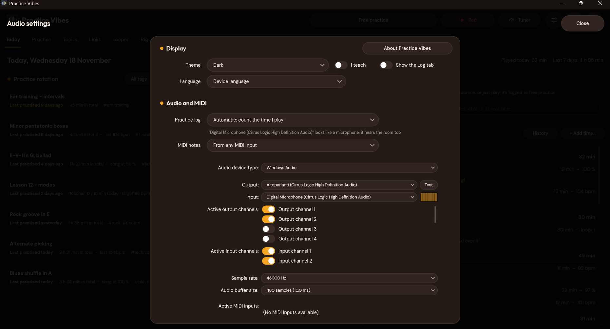
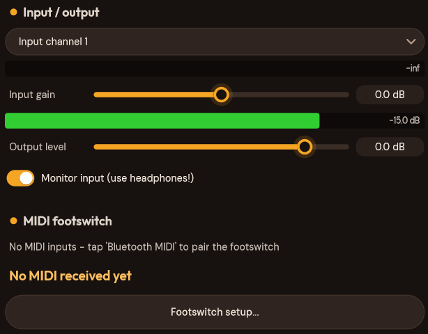

# 2. First setup

Four things to do once: connect your instrument, get the delay down, turn on monitoring, and choose where your library
lives. Then pick a theme if you like. About ten minutes.

---

## Connect your instrument

1. Plug your instrument into your audio interface (a guitar or bass into the instrument input, a keyboard's
   line or headphone output into a line input, a microphone into the mic input) and the interface into the iPad or
   computer. Plug in your headphones
   (into the interface if it has a headphone socket).
2. Open Practice Vibes. On the iPad, allow **Microphone** when asked: that's how iPadOS names any audio input, your
   interface included. On a Mac, allow microphone access too.
3. Tap the **settings** button in the top bar (the icon with sliders) to open **Audio settings**:
   - **Output**: your interface or headphones.
   - **Input**: your interface. Under **Active input channels**, make sure the input your instrument is plugged into
     is ticked.
   - **Sample rate**: 48000 Hz or 44100 Hz are both fine.
   - **Audio buffer size**: see the next section.
4. Close Audio settings and open the **Rig** tab. Under **Input / output**, choose your instrument's input in the
   input box (e.g. "Input 1"), then play. The input meter should move.

> **"No audio input"** in the Rig tab means the app has no input open. Check the Input device and the Active input
> channels in Audio settings. The rest of the app (player, metronome…) keeps working without one.

---

## Get the delay down (latency)

> **How it works.** When you play through the app, the sound of your instrument goes into the interface, is turned into
> numbers, passes through the app (and your effect plugins), and comes back out. The app doesn't handle the sound one
> sample at a time but in small batches called **buffers**. Each batch must be collected before it can be processed,
> so a bigger buffer means a longer wait between playing a note and hearing it: the **latency**.
>
> - Around **10 milliseconds** or less feels like playing an amp.
> - Above about **20 ms** you start to feel you're "behind" the sound.
> - Too small a buffer and the computer can't keep up: you hear **crackles and clicks**.
>
> So the goal is the smallest buffer that doesn't crackle.

How to find it:
1. In **Audio settings**, set **Audio buffer size** to a small value: 128 samples is a good start (Audio settings
   shows the time in milliseconds next to it).
2. Turn on monitoring (next section), load a song, start the metronome and play for a minute.
3. Crackles? Go one size up (192, 256…). Feels sluggish and no crackles? Try one size down (64, 96).

Other things that help:
- **Windows**: if your interface came with an **ASIO** driver (most music interfaces do: install it from the
  maker's website), choose the device type **ASIO** in Audio settings and pick the driver. ASIO usually gives the
  lowest latency. The **Control Panel** button opens the driver's own settings (buffer size, sample rate).
  Without an ASIO driver, try **Windows Audio (Exclusive Mode)** or **(Low Latency Mode)**: they usually allow
  smaller buffers than plain **Windows Audio**. Close other apps that play sound. On a laptop, plug in the charger and use a "best performance" power mode.
  If the ASIO interface is unplugged when you start the app, it plays through Windows Audio for that session and goes
  back to ASIO the next time the interface is connected (as long as you didn't change the audio settings meanwhile).
  Only one app at a time can usually use an ASIO driver: close your DAW first.
- **iPad / Mac**: latency is usually low out of the box. Use a wired interface and wired headphones.
- **Bluetooth headphones** add a large delay (often 150 ms or more) that no setting can remove. Fine for listening to
  songs, not for hearing your own playing.
- Some effect plugins (especially amp simulators with "high quality" modes) add their own delay. If it suddenly feels
  slow after adding a plugin, try bypassing it.

The looper also has a calibration helper so overdubs land exactly on time even with some latency. See chapter 7.

---

## Hear yourself: monitoring

Practice Vibes starts with your instrument **muted** every time. That's on purpose: on an iPad with the built-in
microphone and speaker, sending the input straight to the output would cause loud feedback (howling).

> **How it works.** "Monitoring" means sending your instrument, after its effect plugins, to your headphones. With it off
> the app still *hears* your instrument (for the tuner, the practice log, the looper and recording takes); you just
> don't hear it through the app.

- To hear yourself through the app: **Rig** tab › **Monitor input (use headphones!)** on.
- Leave it off if you already hear your instrument another way: through an amp, a keyboard's own speakers, or through your interface's own
  "direct monitoring" knob or switch. (With both on you'd hear yourself twice, slightly out of step.)
- **Input gain** sets how strongly your signal enters the app. Aim for the meter to move well up when you play
  hard, without hitting the top. (Double-tap the slider to go back to 0 dB.)
- **Output level** sets how loud your instrument is in your headphones, compared to songs and the metronome.

---

## Choose where your library lives

Your **library** is the folder that holds your topics (lessons), songs you add, takes you record, your practice log
and saved session plans. It's a normal folder, so you can see and back up everything in it.

Open the **Topics** tab. The first time, it asks **"Where should Practice Vibes keep your topics?"**

- **On one device only**: tap **Use …** (computer: Documents › Practice Vibes › Library) or
  **Keep them on this iPad** (Files › On My iPad › Practice Vibes › Library).
- **On several devices** (e.g. iPad and PC sharing the same topics and practice log): choose a folder in
  **iCloud Drive**. On the computer tap **Choose a folder...** and pick a folder inside iCloud Drive (on Windows,
  install **iCloud for Windows** first). On the iPad tap **Choose a folder in iCloud Drive** and pick the *same* folder.

> **Why iCloud Drive?** iPadOS only lets apps use a whole folder from iCloud Drive. Google Drive, OneDrive and
> Dropbox are greyed out in the iPad's folder picker. Between computers only (Windows and Mac), any synced folder
> works: OneDrive, Google Drive, Dropbox…

You can change it later: **Topics** › **Library folder...** › **Use a different folder...**. The app doesn't move
your files for you: copy the old library folder's contents to the new place first if you want to keep them.

More about topics and sharing in chapter 9.

---

## Theme

**Audio settings** › **Display** › **Theme**: **Dark**, **Light**, or **Follow the system** (Windows app mode, or the
iPad/Mac Appearance setting, including automatic day/night switching). It changes at once.

---

## Language

**Audio settings** › **Display** › **Language**: **Device language** (the default) or a language from the list. The app
is in English and Italian; with **Device language** it uses Italian on a device set to Italian, English otherwise.
A new choice applies the next time you start the app.

---

## Your settings are kept

The app remembers your audio device, rig, metronome, tuner, footswitch and library folder between sessions. The only
thing that resets on purpose is monitoring, which starts off each time.

Next: **[3. Today](03-today.md)**: let the app keep track of your practice.
