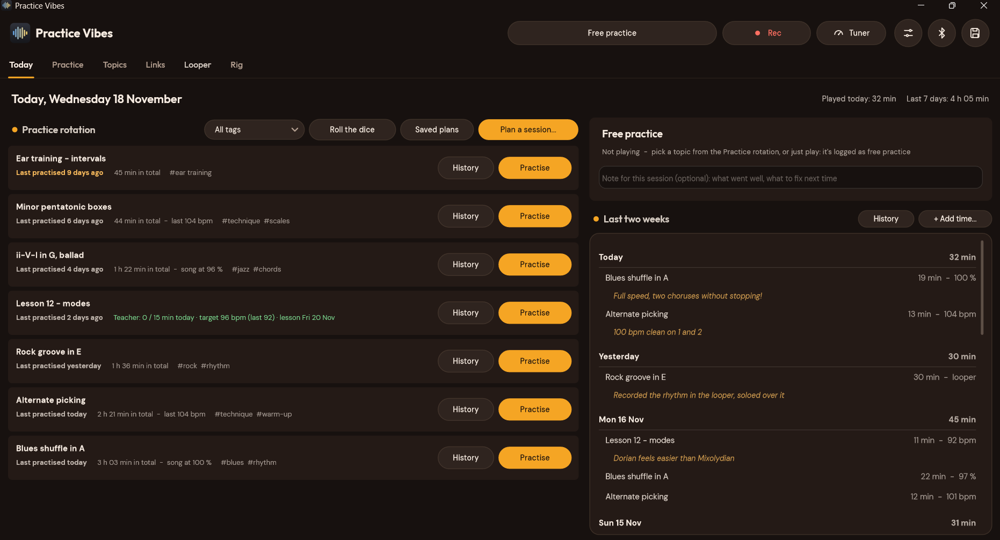
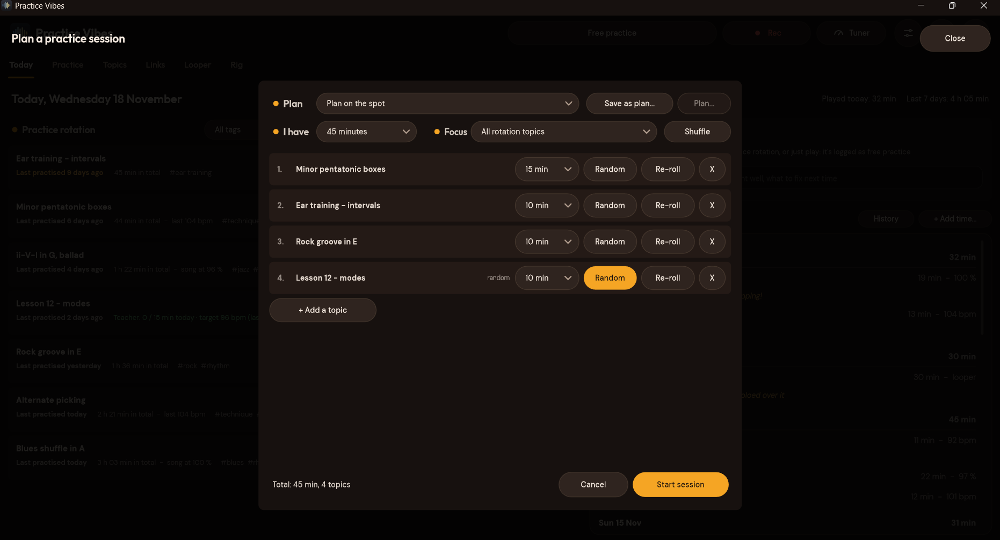
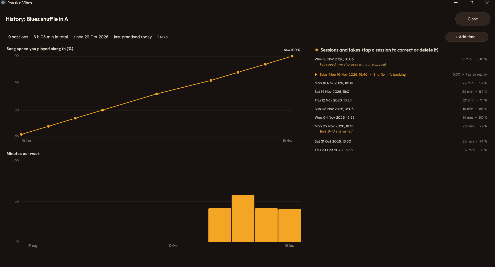

# 3. Today: your practice log and sessions

The **Today** tab is the first thing you see when the app opens. Its idea is simple: **the app records, you play.**
You don't start or stop timers or fill in a diary. Play, and the time is written down for you.

There are no streaks, no reminders and no notifications. It's a log and a few helpers, not a coach that nags.

---

## How your playing is recorded

- The app listens to your instrument input (it doesn't have to be monitored). When the level is clearly above the
  background noise, you're **playing**. Short pauses between phrases still count; after about **5 seconds of
  silence** the clock pauses until you play again.
- The time goes to the **topic you're practising**. A topic becomes the current one when you:
  - press **Practise** on it (Today tab or Topics tab), or
  - open one of its songs, videos or documents.
  
  If no topic is active, the time is logged as **Free practice**.
- The **button in the top bar** always shows what you're practising, with "(playing)" in front while it hears you.
  Tap it for a menu: open the Today tab, stop practising this topic, practise another rotation topic, plan a session.
- Each entry also notes the **metronome tempo** or **song speed** you played along to and whether you used the
  **looper**. These feed the progress charts in History.
- Entries shorter than **20 seconds** aren't kept, so a quick noodle doesn't clutter the log.
- **Add a note** to the session you're in ("clean at 90 bpm, the bend is still flat"). It's saved with the entry.

### With the built-in microphone: Start and Pause

A microphone hears the room too: talking, a TV or the street would be counted as playing. So when the app's input is
a microphone (the iPad's or laptop's own mic, a headset, a Bluetooth headset), it doesn't listen for playing:
- The Today tab shows "Not timing (microphone input)" and a **Start** button. Tap **Start** when you begin; the clock
  runs until you tap **Pause**, whether you're playing or reading the next exercise.
- Forgot to pause? After **10 minutes** without a sound the clock pauses by itself.
- Picking another topic keeps the clock as it is (running or paused).

With an audio interface (USB, or an ASIO driver on Windows) the app counts automatically, as described above.

The app guesses which kind of input you have. To change it, open **Audio settings** and pick for **Practice log**:
**Automatic: count the time I play**, **Only between Start and Pause** or **Only MIDI keyboard notes** (next
section). The choice is remembered for that input only: plug in your interface and it counts automatically again.

> **Tip:** an audio interface is still the best way: you play and the app does the rest.

### With a MIDI keyboard

Connect a MIDI keyboard (USB, or Bluetooth MIDI on the iPad) and the notes you play count as playing, just like sound on
the input: the same 5-second pause rule applies. You don't need an audio input for this, and it works next to one (a
digital piano's audio out into the interface *and* its MIDI cable, say). Holding the sustain pedal or turning knobs
doesn't count, and a footswitch's presses never do.

In **Audio settings**:
- **MIDI notes**: **From any MIDI input** (the default), **Only from** one device (if other MIDI gear sends notes too,
  e.g. a drum pad or a sequencer), or **Don't count MIDI notes**.
- **Practice log** › **Only MIDI keyboard notes (ignore the sound)**: for when the input is a microphone in the room
  (talking would count otherwise) but you play a MIDI keyboard. Only your notes count, no Start button needed.

With a microphone and the default Start / Pause timing, your MIDI notes keep the clock from pausing itself.

---

## The practice rotation

Not every topic needs regular practice: some are reference material. The ones you want to keep working on go in
the **practice rotation**: open the topic in the **Topics** tab and turn on **In practice rotation**.

On the Today tab, the **Practice rotation** list shows those topics, **longest neglected first**, with when you last
practised each one.

**Practise** brings back the setup you left the topic with last time: the song or video, the A-B loop, the speed,
the stem mix and the metronome tempo. You pick up exactly where you stopped. A topic you haven't practised yet opens
its first song or video.

If your teacher gave you an assignment on a topic, its row shows it instead of your progress, for example
"Teacher: 5 / 15 min today · target 96 bpm (last 88) · lesson Fri 20 Nov". It sits beside your own plan and changes
nothing in it (chapter 9).

---

## Roll the dice

Can't decide what to practise? **Roll the dice** picks a rotation topic at random. The longer you've left one, the more
likely it comes up. A strip says "The dice says: …", with **Practise** to start it. Roll again if you don't like the
answer.

The **tag box** next to it (**All tags**, or a tag such as #technique) limits the dice and the session planner to
topics with that tag.

---

## Plan a session

For a structured session: **Plan a session...**

1. Choose how long you have (**I have** 15 minutes to 2 hours) and, optionally, a **Focus** tag.
2. The app suggests 3 to 5 **slots**: different rotation topics with minutes each, favouring the neglected ones.
3. Adjust it:
   - change a slot's minutes,
   - **Re-roll** a slot (another topic),
   - **X** removes a slot, **+ Add a topic** adds one (roll the dice or pick by name),
   - **Shuffle** redoes the whole plan.
4. **Start**.

While the session runs:
- The first topic opens with its last setup. The **top bar** shows "1/4 Topic – 14:59", and the Today tab shows the
  session with all its slots.
- **The slot clock only runs while you play.** Right after Start it waits; answer the phone and it pauses; play again
  and it continues. "15 minutes" means fifteen minutes of actual playing.
- When the time's up you hear **one soft chime** and the top bar turns amber: "Time's up – next: …". Nothing moves on
  by itself: finish your phrase, then choose **Next topic**, or **+5 min** if you want more. The same choices are in
  the top-bar button's menu.
- On the last slot, **Finish** shows a summary ("Session over: 45 min, 4 topics"). **End** stops early, with the
  same summary for what you did.

---

## Saved plans

If you like a session, keep it: in the planner, **Save as plan...** and give it a name (e.g. "Morning warm-up").

- **Saved plans** (on the Today tab, next to Plan a session) lists your plans:
  - **Start** runs it as it is.
  - **Change for today...** opens it in the planner. Your changes apply to today only; the saved plan stays as it was.
    To keep the changes, use **Save as plan...** › **Save changes to "…"** (or **Save as a new plan...**).
- **Random slots**: turn on **Random** on a slot and, in a saved plan, it picks a different rotation topic every time
  (or a random one with the Focus tag). Good for "one neglected topic" at the end of a routine.
- **Plan...** › **Rename...**, **Duplicate**, **Delete...** manage your plans.
- If you delete a topic that a plan uses, its slot shows as *Missing topic* and is skipped. Re-roll it or remove it.

Plans are stored in your library folder, so they're on all your devices if the library is shared.

---

## History and progress

- **History** on a topic (Today rotation list, or the topic's page in Topics): total time and sessions, a line of
  the **tempo** and/or **song speed** you played along to over time, **minutes per week** for the last 12 weeks, and
  every session with its notes and takes.
- **History** on the Today tab (next to Last two weeks): the same across all topics, plus **time per topic**. Tap a
  topic's bar for its own History.

---

## Fixing the log

- **iPad in portrait:** the rotation list and **Last two weeks** take turns. **Show** next to Last two weeks puts
  the list in the rotation's place; **Hide** brings the rotation back.
- **Wrong entry?** Tap it, in **Last two weeks** or in a History, to change its topic, start time, minutes or note,
  or **Delete entry**. Totals and charts update, on every device.
- **Free practice that was really a topic?** Tap the entry and pick the topic in the **Topic** menu. It works the
  other way too: move an entry to another topic, or back to **Free practice**.
- **Practised away from the app?** **+ Add time...** (Today tab or a topic's History): choose the topic (or Free
  practice), the start, the minutes and a note. The entry is marked "added by hand".

---

## Practice without playing

For ear training, theory or reading, there's nothing to "hear". Turn on **Timed without playing** on that topic
(Topics tab). When you practise it, the clock runs as soon as the topic is active, whether you play or not:
- The Today tab shows "Timing (without playing)" with **Pause** / **Resume** for breaks, and **Stop** when you're
  done.
- If you forget to stop it, correct the entry afterwards (see Fixing the log).

Its entries are marked "clock time" and count in your totals like any other time.

Next: **[4. The player](04-player.md)**: slow down, loop and pull apart a song.
