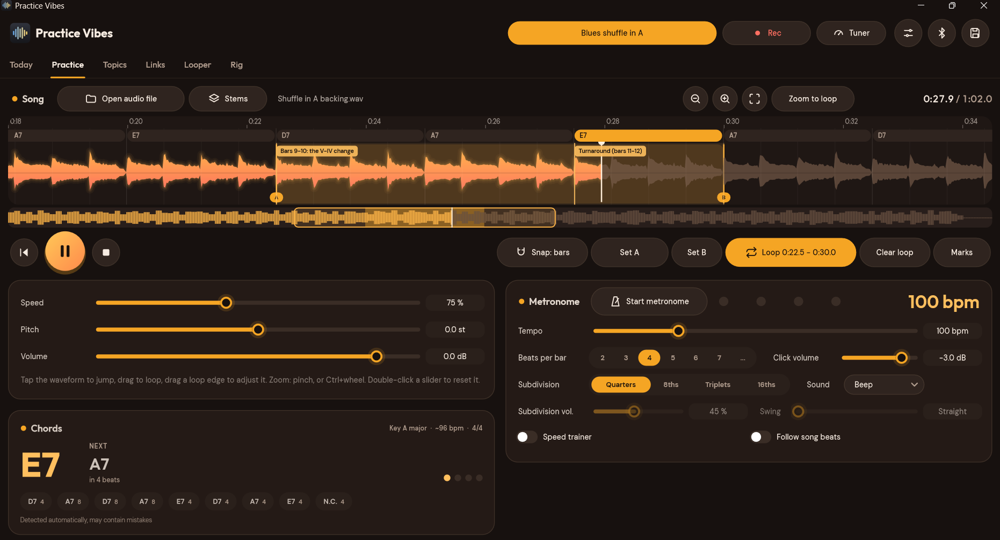
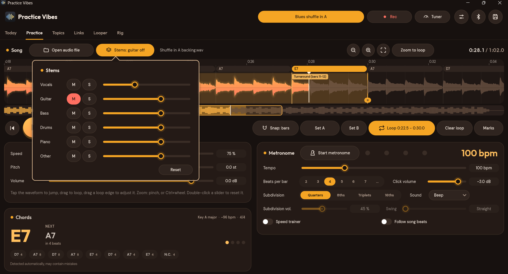

# 4. The player: slow down, loop, pull apart

The **Practice** tab is where you play along with songs. Load a song, slow it down, loop the hard part, mute the
guitar on the recording and play it yourself.

---

## Loading a song

- **Open audio file** (folder icon) and pick a file: WAV, AIFF, FLAC, MP3 or M4A.
- Or open a song from a **topic** (Topics tab): it loads here, and that topic becomes the one you're practising.
- **Windows**: right-click a song in Explorer › **Open with** › **Choose another app**, then browse to
  Practice Vibes.exe. **Mac**: right-click a song in Finder › **Open With** › **Practice Vibes**.

If the song isn't in your library, the app asks **"Add to your library?"**. **Add to Inbox** copies it into your
library's Inbox (the original stays where it was), so it's on your other devices and keeps its stems next to it.
**Not now** just plays it.

While a song loads, the app also works out its chords, beats and bars ("Analysing chords..."). See chapter 5.

---

## Playing

- The big round **Play** button (or the **space bar**) plays and pauses. The buttons next to it go **back to the start**
  and **stop**.
- **Tap the waveform** to jump to that point.
- **Volume** sets the song's level against your instrument.

---

## Speed and pitch

- **Speed** 25–150 %: slows the song down or speeds it up **without changing its pitch**. Start slow (e.g. 70 %) and
  work up.
- **Pitch** ±12 semitones: changes the key **without changing the speed**. Useful for a song recorded in a tuning
  you're not in (e.g. −1 for a song tuned a half step down), or to practise in another key. It moves in steps of
  0.1, so you can also nudge a recording that's slightly off concert pitch.
- **Double-tap a slider** to put it back (100 %, 0 semitones).

---

## The A-B loop

Loop a section and play it over and over:
- **Drag across the waveform** from where the loop should start to where it should end. Or play the song and tap
  **Set A** at the start and **Set B** at the end.
- **Drag a loop edge** to adjust it.
- The **Loop** button (it shows the loop times) turns the loop on and off without losing it. **Clear loop** removes it.

**Snap** makes loop edges land exactly on the song's bars or beats, so the loop repeats in time. Tap the button to
cycle **Snap: bars** › **Snap: beats** › **Snap: off**. It works because the app detected the beats (chapter 5); for a
free-time piece, turn it off.

To keep a loop for later, with its speed and pitch, use **Marks** > **Save this loop**; **Marks** also puts markers
with a comment on the song (chapter 9).

---

## Zoom

For precise loop points, zoom into the waveform:
- **iPad**: pinch with two fingers, drag to move along the song.
- **Windows**: Ctrl + mouse wheel zooms around the pointer; the wheel alone scrolls.
- **Mac**: pinch on the trackpad or Cmd + wheel; two-finger swipe scrolls.
- The buttons **−** / **+** zoom out and in, **Fit** shows the whole song, **Zoom to loop** fills the view with the loop.
- The thin strip under the waveform shows the whole song with the part you're looking at; tap or drag it to move.

---

## YouTube videos

A YouTube link in a topic or in the Links tab opens the video **inside the app**, on the Practice tab in place of the
waveform. You get the same practice tools:
- a timeline to jump around and drag an **A-B loop**,
- **speed** (YouTube's own steps, e.g. 0.5×, 0.75×, 1×) and **volume**.

Pitch, stems and chord recognition don't work with videos. Only with song files.

When you switch to another tab while a video plays, it shrinks into a **compact player** that floats over the app;
drag it where you like, **expand** it to go back, or close it. **Compact player** on the Practice tab shrinks it
yourself; **Close video** goes back to the song player.

> Some videos can't be played outside YouTube (the owner forbids it). You then get a message and a button to open it on
> YouTube. **iPad**: the very first play of a video may need a tap on the video itself (an iPadOS rule).

---

## Stems: mute your part on the record

**Stems** splits a song into six parts: **vocals, guitar, bass, drums, piano** and **other**. Then you can mute the
recorded guitar (or bass, or piano) and play the part yourself, solo the bass and drums to lock in with the rhythm section, or turn the
vocals down.

1. Load a song and tap **Stems** (next to Open audio file) › **Separate stems**.
2. The first time only, the app downloads the separation model (115 MB).
3. Separation runs in the background: about **3 minutes for a 4-minute song** on a typical laptop. You can close the
   window and keep practising; the Stems button shows the progress.
4. When it's done, the window becomes a **mixer**: for each stem, **M** (mute), **S** (solo: only soloed stems play) and a
   volume slider. The Stems button shows your mix, e.g. "Stems: guitar off".

- Speed, pitch, loops and the metronome keep working with stems.
- The stems are saved next to the song (about 30 MB per 4 minutes), so a song is separated only once, and they come
  back by themselves the next time you open it.
- **Practise** on a topic brings back its stem mix.
- A footswitch can mute and unmute a stem of your choice (chapter 11).
- Old stems can be removed in **Storage and clean-up** (chapter 9). They can always be made again.

> **iPad:** separation needs the Windows or Mac app (it's too heavy for the iPad). If your library is shared through
> iCloud Drive, songs separated on the computer have their stems on the iPad too.

> Separation is very good but not perfect: a muted guitar can leave a faint "ghost", and similar instruments (e.g.
> two guitars, or a guitar and a keyboard) may end up in the same stem.

Next: **[5. Chords, beats and the metronome](05-chords-metronome.md)**
