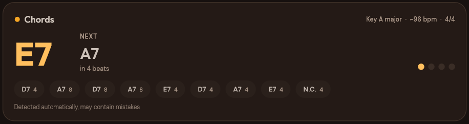

# 5. Chords, beats and the metronome

---

## Chord recognition

When you load a song, the app listens to it and works out its **chords**, **beats**, **bars** and **time signature**.
This takes a few seconds ("Analysing chords...").

- The **Chords** card on the Practice tab shows the chord playing now in big letters, the **NEXT** one and how many
  beats until it comes, and the chords after that. Dots light up for each beat of the current chord. The song's
  key, tempo and time signature are at the top right.
- The **chord lane** above the waveform shows every chord along the song, the current one highlighted. Handy for
  seeing where the changes are when you set a loop.
- **Slash chords** are recognised too (D/F# = a D chord with F# in the bass).
- Time signatures: 3/4, 4/4, 5/4 and 7/4, including changes in the middle of a song.
- Chords follow the song when you change speed or pitch (with pitch shifted, you see the chords as you hear them).

> It's an automatic guess, so treat it as a helpful starting point, not a transcription. Busy arrangements and
> unusual chords can come out simplified, and it will even "find" chords in a drum solo or speech. If a section
> sounds wrong, trust your ears.

---

## The metronome

The metronome is on the Practice tab. **Start metronome** starts it; it keeps running on the other tabs.

- **Tempo** 30–300 bpm.
- **Beats per bar**: tap a number (2–7, or **…** for others). The first beat of the bar is accented.
- **Sound**: **Beep**, **Click** or **Drums** (kick on the downbeat, snare on 2 and 4, hi-hat on the subdivisions).
- **Click volume** sets the metronome's level.

### Subdivisions and swing
- **Subdivision**: **Quarters**, **8ths**, **Triplets** or **16ths**. The extra clicks are softer than the beats, and
  **Subdivision vol.** sets how soft.
- **Swing** (8ths and 16ths): slide from **Straight** to **Shuffle** to **Dotted**. Use it to practise blues shuffles
  and swing feels.

### Speed trainer
Builds speed gradually, without you touching anything:
1. Set the starting tempo.
2. Turn on **Speed trainer**: its settings appear underneath. **Add** 2 bpm **every** 4 **bars** (or minutes),
   **up to** e.g. 120 bpm. (They hide again when you switch the trainer off.)
3. Start the metronome and play. The tempo climbs by itself until it reaches the target.

Your best tempo is saved with the topic's practice log and shows on its History chart (chapter 3).

### Follow song beats
**Follow song beats** makes the metronome click along with the **song**, on the beats the app detected, instead of
at a fixed tempo. Useful for:
- hearing the beat clearly in a song with a loose or hard-to-follow rhythm,
- songs that speed up or slow down (live recordings),
- keeping the click in step when you slow the song down or loop it.

It needs a song loaded. While the looper has loops, tempo and meter are locked (chapter 7).

Settings are kept between sessions. **Practise** on a topic brings back the tempo you used last time with it.

Next: **[6. Recording takes](06-takes.md)**
