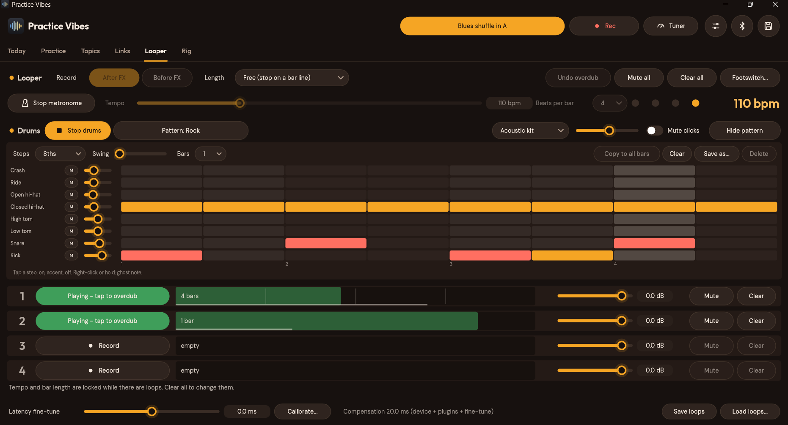

# 7. Looper and drum machine

The **Looper** tab records short loops of your playing and repeats them, so you can play over your own chords, build
up layers, or practise soloing over a progression. A built-in drum machine plays along in time.

---

## How the looper keeps time

The looper is locked to the **metronome**. Loops are a whole number of **bars** at the metronome's tempo and
time signature, and every track starts on a bar line. That's why loops never drift apart, and why the drum machine
always fits.

So: **set the tempo and beats per bar first** (on the Looper tab, or the metronome on the Practice tab). Once there are
loops, tempo and meter are locked until you clear them.

---

## Recording a loop

There are **4 tracks**. Each has one big button that does everything:

1. **Record**: tap it. The metronome starts if needed; the track shows "Waiting for bar line..." and recording starts
   on the next bar.
2. Play. **Length** decides when it stops:
   - **1–16 bars**: stops by itself after that many bars and starts playing.
   - **Free (stop on a bar line)**: tap again when you're done; it stops at the end of the current bar.
3. **Playing – tap to overdub**: tap to record another layer on the same track; tap again to stop overdubbing.
4. **Undo overdub** removes the last layer.

Each track also has **Mute** / **Unmute** and **Clear**. **Mute all** and **Clear all** act on every track.
Tracks can have different lengths (e.g. a 4-bar chord loop and a 1-bar riff); they stay in step. A track holds up to
60 seconds.

- On a computer, keys **1**–**4** press the track buttons.
- A footswitch is much handier than tapping the screen with an instrument in your hands (chapter 11).
- Loops keep playing when you switch to other tabs.

---

## Before or after the effects

**Record: After FX / Before FX** decides what a loop captures:
- **After FX** (default): your instrument as you hear it, with your rig's effects. Change your sound afterwards and the loop
  keeps the old one: e.g. a clean rhythm loop, then a distorted solo over it.
- **Before FX**: your dry instrument. Loops are played back through the rig, so changing the effects changes the loops too.
  Good for trying different sounds on the same part.

The choice is locked while there are loops.

---

## Latency compensation

> **How it works.** Your playing reaches the app a few milliseconds late (the latency from chapter 2), and you hear the
> loops a few milliseconds late too. Without correcting this, each overdub would land slightly behind the beat, and the
> layers would sound "flammed". The looper corrects it using what the audio device reports, but some devices don't
> report it exactly.

To check it once:
1. **Calibrate...** on the Looper tab.
2. Play **short muted notes** **right on the clicks**, 12 times: on guitar, strum with the strings damped by your
   left hand; on keyboards, short staccato notes; on drums, a rim click.
3. The app measures how late they arrive and sets the compensation. The value shows at the bottom ("Compensation …").

**Latency fine-tune** lets you nudge it by hand if overdubs still feel early or late. Calibrate again after changing
audio interface or buffer size.

---

## Saving loops

- **Save loops** keeps the session: one WAV file per track plus a mix of all of them, the tempo and meter, and the drum
  pattern. Saved in Documents › Practice Vibes › Loops (iPad: Files › Practice Vibes › Loops); **Show the Loops
  folder** opens it on a computer. The WAV files open in any audio app.
- **Load loops...** brings a session back (the looper must be empty: Clear all first). The metronome takes the
  session's tempo and meter.

---

## Drum machine

The **Drums** row on the Looper tab plays a drum pattern in time with the loops, but isn't recorded into them.

- **Play drums** starts the pattern (and the metronome if needed); **Stop drums** stops it.
- **Pattern**: choose one of the 13 **Starter patterns** (from "Kick on the beat" and "Basic beat" through Rock, Funk,
  Shuffle, Slow blues, Jazz swing, Reggae and Bossa nova to "Waltz (3/4)" and "Ballad (6/8)") or one of
  **My patterns**. A pattern in another meter switches the metronome to match.
- **Kit**: **Acoustic kit** (a recorded drum kit) or **Electronic kit** (a drum machine).
- **Drums volume**, and **Mute clicks** to silence the metronome while the drums keep time.
- The pattern starts again from its first bar with your first loop, so a fill on bar 4 of a 4-bar pattern lands at
  the end of a 4-bar loop.

### Editing a pattern
**Edit pattern** shows the grid (**Hide pattern** hides it again to save room):
- Rows: crash, ride, open hi-hat, closed hi-hat, two toms, snare, kick. Columns: the steps of a bar.
- Tap a step: **on** → **accent** → **off**. Right-click (iPad: hold) for a soft **ghost** note.
- **Steps**: 8ths, Triplets or 16ths; **Swing** for a shuffle feel.
- **Bars**: 1, 2, 4 or 8, with a tab per bar; **Copy to all bars**, **Clear** (the bar shown).
- Each drum has its own mute and volume.
- **Save as...** keeps it under a name in My patterns (Documents › Practice Vibes › Drum patterns).

Next: **[8. Tuner](08-tuner.md)**
