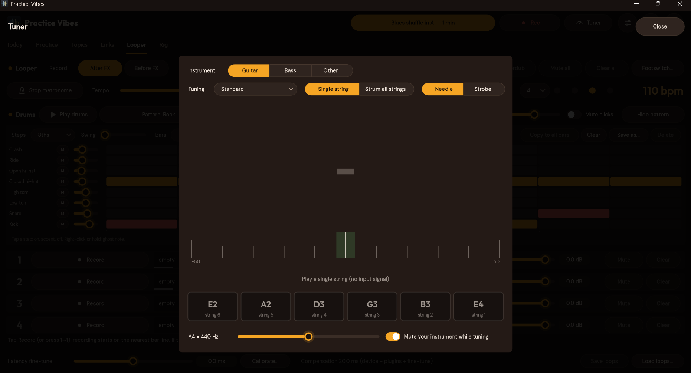

# 8. Tuner

Tap **Tuner** in the top bar (or use a footswitch). The tuner opens over whatever you're doing; close it to go back.

---

## Choose your instrument

**Instrument** at the top: **Guitar**, **Bass** or **Other**.
- **Guitar** and **Bass** show a row of strings for your tuning, and can check all strings at once.
- **Other** is a plain chromatic tuner for anything else (keyboard, violin, wind instruments, your voice): it shows the
  note you play and how far off it is, without strings.

Each instrument keeps its own tuning, so switching between guitar and bass doesn't lose anything.

---

## Tuning one string at a time

1. **Single string** (the default). Play one open string (or one note) and let it ring.
2. The tuner shows the **note** and octave, and how far off it is in **cents** (a cent is 1/100 of a semitone).
   - Needle left = **flat** (too low): tighten the string. Needle right = **sharp** (too high): loosen it.
   - **Green** = in tune (within 3 cents).
3. The row of strings shows your tuning; the nearest string lights up. If you're far off it says e.g. "2 st flat"
   (2 semitones), so you know which way to turn.

**Mute your instrument while tuning** silences your instrument in your headphones while the tuner is open.

---

## Needle or strobe

- **Needle**: the familiar view, good for getting close quickly.
- **Strobe**: a band that drifts left when flat and right when sharp, and **stands still** when you're exactly in tune.
  The slower it moves, the closer you are. Best for the last cent or two.

---

## Other tunings

**Tuning** chooses what the string row and "nearest string" follow:
- **Guitar**: Standard, Half step down, Full step down, Drop D, Drop C, DADGAD, Open G, Open D, Open E, Open C.
- **Bass**: Standard, Half step down, Full step down and Drop D for 4 strings; Standard (low B) and High C for
  5 strings; Standard for 6 strings.

For anything else, **tap a string** in the row and choose its note: that makes a **Custom** tuning. Your choice is kept.

---

## Strum all strings

A quick check of the whole guitar or bass:
1. **Strum all strings**.
2. Strum the open strings once and let them ring.
3. After about half a second, each string shows **in tune**, **flat** or **sharp**, all at once. A string the tuner
   couldn't hear says "not heard".

Fix the ones that are off (in Single string mode, or just by ear), then strum again to check.

---

## Reference pitch

**A4 =** sets the reference: 440 Hz is standard. Choose between 430 and 450 Hz to match a piano, a recording or a band
that tunes differently. Double-tap the slider to go back to 440.

Next: **[9. Topics and Links](09-topics-links.md)**
