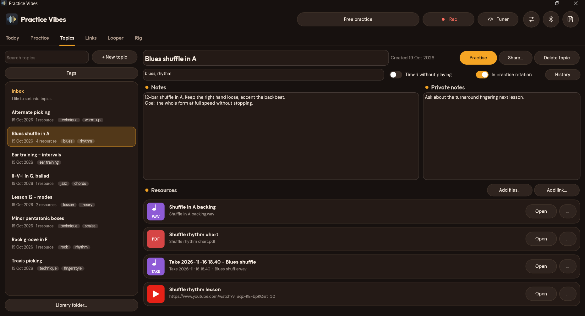

# 9. Topics and Links

**Topics** are where your practice material lives: lessons, songs, techniques, exercises. **Links** is a separate
list of useful websites.

---

## What's a topic?

A topic is anything you practise: "Alternate picking", "Autumn Leaves", "Lesson 12 – modes". Each topic has:
- a **title** and **tags** (e.g. technique, jazz, lesson): used for search, the dice and the session planner,
- **Notes**: what to practise, how, what your teacher said. Saved as you type,
- **Resources**: the songs, PDFs, images, videos and links that go with it, in the order you choose,
- **In practice rotation**: puts it on the Today tab's list (chapter 3),
- **Timed without playing**: for ear training or theory (chapter 3),
- **History** and **Practise** buttons.

---

## Creating and filling topics

1. **+ New topic**, type a title. Add tags under the title, separated by commas.
2. **Add files...** copies documents, images or audio files into the topic. On a computer you can also **drag files**
   from Explorer or Finder onto the topic.
3. **Add link...** adds a YouTube video, a Google document or any web page.
4. Each resource's **…** menu: **Edit title and description...** (and tags), **Move up** / **Move down**,
   **Show in folder**, **Remove**.

Opening a resource:
- **Songs** open in the player (Practice tab); **YouTube** links in the app's video player.
- **PDFs, images, text and videos** open in a viewer inside the app.
- **Web pages** open in your browser.
- Other files (e.g. Word documents) open in their own app on a computer. **Open outside the app** is always in the
  **…** menu.

Opening something from a topic makes it the topic you're practising, so your playing time goes to it.

---

## Finding things

- **Search topics**: type the start of a word. It finds topics by title, and also by the names, tags and notes inside
  them (the list says where it matched, e.g. "in notes").
- **Tags**: show only topics with a tag.
- **Delete topic** (on the topic's page) moves its folder to the Recycle Bin / Bin. On the iPad it's deleted for good.

---

## The Inbox

**Inbox** collects files that aren't in a topic yet: songs you added from elsewhere ("Add to Inbox"), takes recorded in
free practice, files dropped into the library folder from another device. Use **Move to topic...** to file each one.

---

## Your library folder, and sharing between devices

Everything above is stored as plain files in your **library folder** (chosen in chapter 2): one folder per topic,
with its files and a small topic.xml. You can browse it with Explorer, Finder or the Files app, and back it up like
any folder. **Library folder...** › **Show the folder** opens it (on a computer).

If the library is in **iCloud Drive** (or, between computers only, another synced folder), all your devices share:
topics, songs, takes, stems, the practice log, saved plans and links. Changes from another device show up after the
cloud has synced, usually within a minute. **Library folder...** › **Check for changes now** looks right away.

> **Edited on two devices at once?** The cloud may keep two copies of a topic. The topic then shows "The cloud sync made
> an extra copy" with **Choose version...**: pick the one to keep; the other goes to the bin.

> **iPad and the cloud:** files that are only "in the cloud" are downloaded in the background, so a big library may take
> a minute or two to fill in the first time.

---

## Sharing a topic with a teacher, a student or a bandmate

**Share...** (next to **Practise**) packs the topic into one file you can send by AirDrop, Mail, WhatsApp or Messages.

1. **Send as**: **Practice Vibes topic** if the other person has the app; **Document for anyone** if they don't
   (a web page with the notes, the links and the files: it opens on any phone or computer and can be printed).
2. Tick the files that go in. Your own recordings and documents are ticked; songs aren't, because they may be
   commercial recordings: the other person uses their own copy. The total tells you if it fits in an email.
3. **Share...**: on the iPad the share sheet opens. On a computer the file is shown in its folder: drag it into
   your mail or chat.

The notes, links and resource details always go along. Your **Private notes** (next to Notes) and your practice log
never do.

**Receiving a topic**: tap the file in Mail, WhatsApp or Files and choose Practice Vibes (on a computer, double-click
it, or **Library folder...** › **Import a shared topic**). You see what will happen first:
- a **new topic**, or **updates your topic** if you already have it (e.g. your teacher sent this week's version):
  new resources and changed notes are added, your private notes stay as they are. **Import as copy** keeps yours
  untouched.
- songs left out by the sender are found in your library if you have them (same file name). If not, **Locate...**
  lets you point to your copy, or the song stays listed as missing.

## Marks: markers and saved loops

While a topic's song plays, **Marks** (next to **Clear loop**) lets you:
- **Add a marker** at the current time, with a short comment ("solo starts", "bar 17: watch the fingering"),
- **Save this loop**: the A-B loop together with its speed and pitch,
- jump back to any of them: a saved loop brings back its speed and pitch too.

They appear on the waveform as small flags. With a recorded take open, **Marks** adds comments at a time in the take
("1:23 rushing here"): handy for a teacher listening to a student's take. Marks are kept in the topic, so they go
along when you share it.

## Teaching mode

Teachers: turn on **I teach** in the settings (gear icon, Display). A **Teaching** button appears in the top bar.
Tap it when a lesson starts: the app works as usual (pick a topic, play a song, make a loop) but nothing goes to your
practice log. Tap it again when the lesson is over. The app always starts with teaching off, so a lesson you forgot to
end doesn't swallow your own practice the next day.

When you end a lesson, the app offers to send the topic to your student. Takes you record during a lesson are named
"Demo ..." so your student can tell them from their own.

With **I teach** on you also get:
- **Assignment...** on each topic: a goal, a target tempo, minutes a day and the next lesson. It travels with the topic
  and shows on your student's Today tab ("Teacher: 5 / 15 min today").
- a **Student** box (a first name or nickname: it stays on your devices and is never sent), and a **Students** list in
  the **Tags** menu to see one student's topics.
- **As a new topic** in the Share dialog: the same lesson for another student, as their own separate copy. It's ticked
  for your own lesson topics, and unticked for a topic that already belongs to a student (then you're replying, and
  their copy is updated). The line under it says which will happen.
- **Groups** for ensembles: **Tags** › **New group (ensemble)...**, give it a name and its members (first names or
  nicknames). In the Share dialog pick the group under **To**: **one file for the whole group** (send it once to the
  group chat) or **one file per member** (on the iPad and Mac a list then shows each member with their own **Share...**
  button, so each file goes to the right chat). When members send their copy back, the app asks **Who sent this?** (it
  guesses from the name they typed) and keeps each member's copy as its own topic. The topic you sent says who has
  sent something back and who hasn't yet. Groups stay on your devices, like the Student box.

Students can tick **Include my practice on this topic** when they share a topic back: the teacher sees the totals
(time per week, tempo, days in a row), nothing else from their log.

---

## Storage and clean-up

Takes, stems and saved loops add up. **Library folder...** › **Storage and clean-up...** shows how much space each
kind of thing uses, and lists what can be removed:
- takes, saved loop sessions, stems (they can be made again), and the web viewer's cache,
- **Quick select...**: e.g. takes older than a week / a month / 3 months, saved loops older than a month,
- **Remove selected**: on a computer items go to the Recycle Bin / Bin; on the iPad they're deleted for good.

Your songs and documents are never offered for removal.

---

## Links

The **Links** tab is a bookmark list for websites you keep coming back to: a circle of fifths explainer, a scale
finder, a chord dictionary…

- **+ New link**: paste the address; add a title (or leave it empty to use the site's name), tags and a description.
- Tap a link to open it: websites in your browser, YouTube links in the app's video player.
- Each link's **…** menu: **Edit...**, **Move up** / **Move down**, **Copy the address**, **Open in the browser**,
  **Remove link**.
- **Search links** and **Tags** work like in Topics.

Links are kept in the library folder, so all your devices share them.

Next: **[10. Rig](10-rig.md)**
