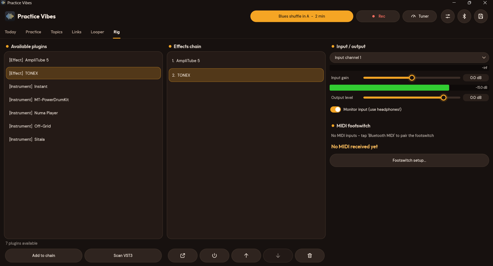

# 10. Rig: your effects

The **Rig** tab is your pedalboard. You plug in amp simulators, pedals and other effects you already own as
**plugins**, and your instrument goes through them before you hear it, record it or loop it.

Practice Vibes doesn't come with its own amp or effects: it uses plugins, so you can pick the sounds you like. Many
good ones are free. You don't need any: with an empty chain your instrument goes straight through. That's often all a
keyboard, an electronic drum kit or a microphone needs.

---

## How it works

> Think of it as a cable run:
>
> **instrument → interface input → Input gain → plugin 1 → plugin 2 → … → Output level → headphones**
>
> - **Input gain** is like the input knob on an amp: how strongly the signal enters. Set it so the input meter
>   moves well up when you play hard, without hitting the top. Too low and the effects sound weak and noisy; too high
>   and it distorts harshly before reaching them.
> - The **Effects chain** is your pedalboard: plugins run top to bottom, like pedals from guitar to amp. Order
>   matters, just like with real pedals: e.g. a wah or compressor before the amp, delay and reverb after it.
> - **Output level** is the master volume of your instrument in your headphones, compared to songs, loops and the
>   metronome.
> - **Monitor input** must be on to hear it at all (chapter 2).
>
> The songs, the metronome and the loops are mixed in after the chain: they don't go through your effects (except
> loops recorded "Before FX", chapter 7).

---

## Plugin types

Plugins are separate apps or programs from other makers that work inside host apps like this one:
- **iPad**: **AUv3** (Audio Unit) plugins: install them from the App Store like any app (search for "AUv3 guitar",
  "AUv3 bass amp" or "AUv3 reverb"). They show up in the list by themselves; if one is missing, tap **Refresh list**.
- **Windows**: **VST3** plugins. Install them with their own installer, then tap **Scan VST3** once.
- **Mac**: **Audio Units** (listed by themselves) and **VST3** (tap **Scan VST3** once).

If a plugin crashes while being scanned, it's skipped and noted in the log; the app carries on.

---

## Building the chain

1. **Available plugins** lists what's installed. Select one and tap **Add to chain** (or double-tap it).
2. The plugin appears in **Effects chain**. Select it to:
   - **Open UI** (window icon): show the plugin's own window, with its knobs and presets,
   - **Bypass** (power icon): switch it off without removing it (like stepping on a pedal),
   - **Up** / **Down** (arrows): change its place in the chain,
   - **Remove** (bin icon): take it out.
3. Play and adjust.

The chain, and every plugin's settings, are saved and come back next time.

> **Tip:** plugins use processing power. If you hear crackles after adding one, try a bigger buffer (chapter 2), or
> turn off the plugin's "high quality" / oversampling mode. Some amp simulators also add their own delay.

A footswitch can bypass the selected plugin (chapter 11).

---

## Play a MIDI keyboard through an instrument plugin

A MIDI keyboard (or pad) makes no sound by itself. Add an **instrument** plugin (a piano, a synth, a drum sampler) and
the app plays it from your keyboard: you hear it, and the looper and recorded takes include it, just like a guitar
through the effects.

1. Connect the keyboard (USB, or Bluetooth MIDI on the iPad).
2. In **Available plugins**, instruments are marked **[Instrument]**. Select one and tap **Add to chain**.
3. It goes to the top of the chain as **Instrument:** *name*. Effects stay below it and process its sound (a reverb
   on a piano, say). There's one instrument at a time: adding another replaces it.
4. Turn on **Monitor input** to hear it (the chain column reminds you), then play.

Good to know:
- **Open UI** shows the instrument's own window (sounds, presets). **Bypass** silences it, **Remove** takes it out.
- Your audio input still plays along with the instrument. If you only play the keyboard, turn **Input gain** down
  to keep the interface's hiss out.
- A footswitch's own messages never play notes.
- The looper's **Before FX** mode records the audio input only, without the instrument: use **After FX** (the
  default) to loop the keyboard.
- Free instruments to start with: on Windows and Mac, e.g. a free piano player plugin; on the iPad, AUv3 instrument
  apps from the App Store (search "AUv3 piano" or "AUv3 synth"). Sampled pianos can use a lot of memory, which
  matters on older iPads.
- Delay: the instrument adds no input delay of its own beyond the audio buffer (chapter 2), so the same buffer
  settings that suit a guitar suit the keyboard. A digital piano's own speakers are still quicker: if you'd rather
  hear those, you don't need an instrument plugin at all (the notes still count as practice time, chapter 3).

Next: **[11. Footswitch](11-footswitch.md)**
