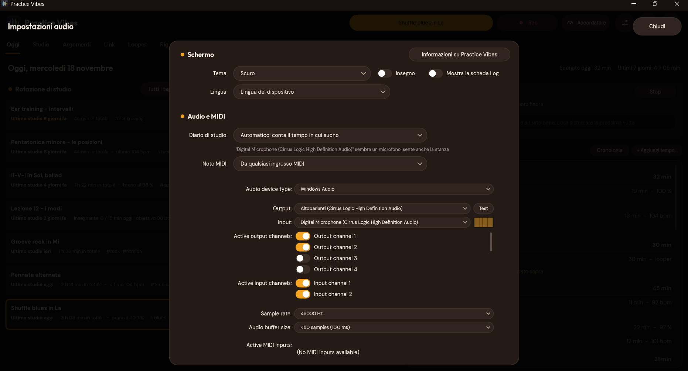
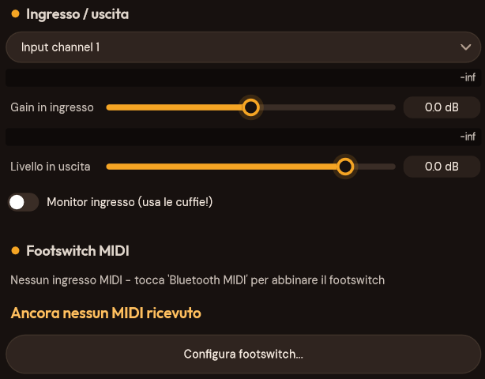

# 2. Prima configurazione

Quattro cose da fare una volta: collegare lo strumento, ridurre il ritardo, attivare il monitor e scegliere dove sta
la tua libreria. Poi, se vuoi, scegli un tema. Circa dieci minuti.

---

## Collega il tuo strumento

1. Collega lo strumento all'interfaccia audio (chitarra o basso nell'ingresso per strumento, l'uscita line o cuffie
   di una tastiera in un ingresso line, un microfono nell'ingresso mic) e l'interfaccia all'iPad o al computer.
   Collega le cuffie (all'interfaccia, se ha una presa cuffie).
2. Apri Practice Vibes. Sull'iPad, consenti **Microfono** quando te lo chiede: è il nome che iPadOS dà a qualsiasi
   ingresso audio, interfaccia compresa. Anche sul Mac consenti l'accesso al microfono.
3. Tocca il pulsante delle **impostazioni** nella barra in alto (l'icona con i cursori) per aprire le **Impostazioni
   audio**. Le voci di questo pannello sono in inglese:
   - **Output**: la tua interfaccia o le cuffie.
   - **Input**: la tua interfaccia. In **Active input channels**, controlla che sia spuntato l'ingresso a cui è
     collegato lo strumento.
   - **Sample rate**: 48000 Hz o 44100 Hz vanno bene tutti e due.
   - **Audio buffer size**: vedi la sezione successiva.
4. Chiudi le Impostazioni audio e apri la scheda **Rig**. In **Ingresso / uscita**, scegli l'ingresso del tuo
   strumento (per esempio "Input 1"), poi suona. L'indicatore di ingresso dovrebbe muoversi.

> **"Nessun ingresso audio"** nella scheda Rig significa che l'app non ha nessun ingresso aperto. Controlla Input e
> Active input channels nelle Impostazioni audio. Il resto dell'app (lettore, metronomo…) funziona comunque.

---

## Riduci il ritardo (latenza)

> **Come funziona.** Quando suoni attraverso l'app, il suono del tuo strumento entra nell'interfaccia, viene
> trasformato in numeri, passa per l'app (e per i tuoi plugin di effetti) ed esce di nuovo. L'app non lavora il suono
> un campione alla volta ma a piccoli blocchi chiamati **buffer**. Ogni blocco va raccolto prima di essere elaborato,
> quindi un buffer più grande significa un'attesa più lunga tra la nota suonata e la nota sentita: la **latenza**.
>
> - Intorno ai **10 millisecondi** o meno sembra di suonare in un amplificatore.
> - Sopra i **20 ms** circa cominci a sentirti "in ritardo" rispetto al suono.
> - Con un buffer troppo piccolo il computer non ce la fa: senti **crepitii e clic**.
>
> Quindi l'obiettivo è il buffer più piccolo che non crepita.

Come trovarlo:
1. Nelle **Impostazioni audio**, imposta **Audio buffer size** su un valore piccolo: 128 campioni è un buon inizio
   (accanto c'è il tempo in millisecondi).
2. Attiva il monitor (sezione successiva), carica un brano, avvia il metronomo e suona per un minuto.
3. Crepitii? Sali di una misura (192, 256…). Ti sembra lento e non crepita? Prova a scendere (64, 96).

Altre cose che aiutano:
- **Windows**: se la tua interfaccia ha un driver **ASIO** (quasi tutte le interfacce musicali ce l'hanno: installalo
  dal sito del produttore), scegli il tipo di dispositivo **ASIO** nelle Impostazioni audio e seleziona il driver. ASIO
  di solito dà la latenza più bassa. Il pulsante **Control Panel** apre le impostazioni del driver (buffer, frequenza di
  campionamento). Senza driver ASIO, prova **Windows Audio (Exclusive Mode)** o **(Low Latency Mode)**: di solito
  permettono buffer più piccoli del semplice **Windows Audio**. Chiudi le altre app che riproducono suoni. Su un
  portatile, collega il caricatore e usa una modalità di risparmio energia "prestazioni migliori".
  Se all'avvio dell'app l'interfaccia ASIO è scollegata, per quella sessione l'app suona con Windows Audio e torna ad
  ASIO la volta dopo che l'interfaccia è collegata (purché nel frattempo tu non abbia cambiato le impostazioni audio).
  Di solito un driver ASIO può essere usato da una sola app alla volta: chiudi prima la tua DAW.
- **iPad / Mac**: la latenza è di solito bassa già così. Usa un'interfaccia e cuffie con il filo.
- Le **cuffie Bluetooth** aggiungono un ritardo grande (spesso 150 ms o più) che nessuna impostazione può togliere.
  Vanno bene per ascoltare i brani, non per sentirti mentre suoni.
- Alcuni plugin di effetti (soprattutto i simulatori di amplificatore con modalità "alta qualità") aggiungono un loro
  ritardo. Se dopo aver aggiunto un plugin tutto sembra lento, prova a metterlo in bypass.

Anche il looper ha un aiuto per la calibrazione, così le sovraincisioni cadono esattamente a tempo anche con un po'
di latenza. Vedi il capitolo 7.

---

## Sentirti: il monitor

Practice Vibes parte ogni volta con il tuo strumento **silenziato**. È voluto: su un iPad con microfono e altoparlante
integrati, mandare l'ingresso direttamente all'uscita farebbe un larsen forte (un fischio).

> **Come funziona.** "Monitor" significa mandare il tuo strumento, dopo i suoi plugin di effetti, alle cuffie. Con il
> monitor spento l'app *sente* comunque il tuo strumento (per l'accordatore, il diario di studio, il looper e i take);
> semplicemente tu non lo senti attraverso l'app.

- Per sentirti attraverso l'app: scheda **Rig** › **Monitor ingresso (usa le cuffie!)** attivo.
- Lascialo spento se senti già il tuo strumento in un altro modo: da un amplificatore, dagli altoparlanti di una
  tastiera, o con la manopola o l'interruttore di "direct monitoring" della tua interfaccia. (Con entrambi attivi ti
  sentiresti due volte, un po' sfasato.)
- **Gain in ingresso** regola quanto forte entra il segnale nell'app. Punta a un indicatore che sale bene quando suoni
  forte, senza arrivare in cima. (Doppio tocco sul cursore per tornare a 0 dB.)
- **Livello in uscita** regola quanto forte senti il tuo strumento in cuffia, rispetto ai brani e al metronomo.

---

## Scegli dove sta la tua libreria

La tua **libreria** è la cartella che contiene i tuoi argomenti (lezioni), i brani che aggiungi, i take che registri,
il diario di studio e i piani di sessione salvati. È una normale cartella, quindi puoi vedere tutto quello che
contiene e farne un backup.

Apri la scheda **Argomenti**. La prima volta chiede **"Dove deve tenere i tuoi argomenti Practice Vibes?"**

- **Su un solo dispositivo**: tocca **Usa …** (computer: Documenti › Practice Vibes › Library) o **Tienili su questo
  iPad** (File › Sul mio iPad › Practice Vibes › Library).
- **Su più dispositivi** (per esempio iPad e PC con gli stessi argomenti e lo stesso diario): scegli una cartella in
  **iCloud Drive**. Sul computer tocca **Scegli una cartella...** e scegli una cartella dentro iCloud Drive (su Windows,
  installa prima **iCloud per Windows**). Sull'iPad tocca **Scegli una cartella in iCloud Drive** e scegli la *stessa*
  cartella.

> **Perché iCloud Drive?** iPadOS permette alle app di usare una cartella intera solo da iCloud Drive. Google Drive,
> OneDrive e Dropbox sono in grigio nella scelta delle cartelle dell'iPad. Solo tra computer (Windows e Mac) va bene
> qualsiasi cartella sincronizzata: OneDrive, Google Drive, Dropbox…

Puoi cambiarla dopo: **Argomenti** › **Cartella della libreria...** › **Usa un'altra cartella...**. L'app non sposta i
file al posto tuo: se vuoi tenerli, copia prima il contenuto della vecchia cartella della libreria nel nuovo posto.

Di più su argomenti e condivisione nel capitolo 9.

---

## Tema

**Impostazioni audio** › **Schermo** › **Tema**: **Scuro**, **Chiaro** o **Segui il sistema** (modalità app di Windows,
o l'impostazione Aspetto di iPad/Mac, compreso il cambio automatico giorno/notte). Cambia subito.

---

## Lingua

**Impostazioni audio** › **Schermo** › **Lingua**: **Lingua del dispositivo** (predefinita) o una lingua dell'elenco.
L'app è in italiano e inglese; con **Lingua del dispositivo** usa l'italiano su un dispositivo impostato in italiano,
altrimenti l'inglese. La nuova scelta vale dal prossimo avvio dell'app.

---

## Le tue impostazioni restano

L'app si ricorda dispositivo audio, rig, metronomo, accordatore, footswitch e cartella della libreria tra una sessione
e l'altra. L'unica cosa che si azzera apposta è il monitor, che parte spento ogni volta.

Avanti: **[3. Oggi](03-today.md)**: lascia che l'app tenga il conto del tuo studio.
