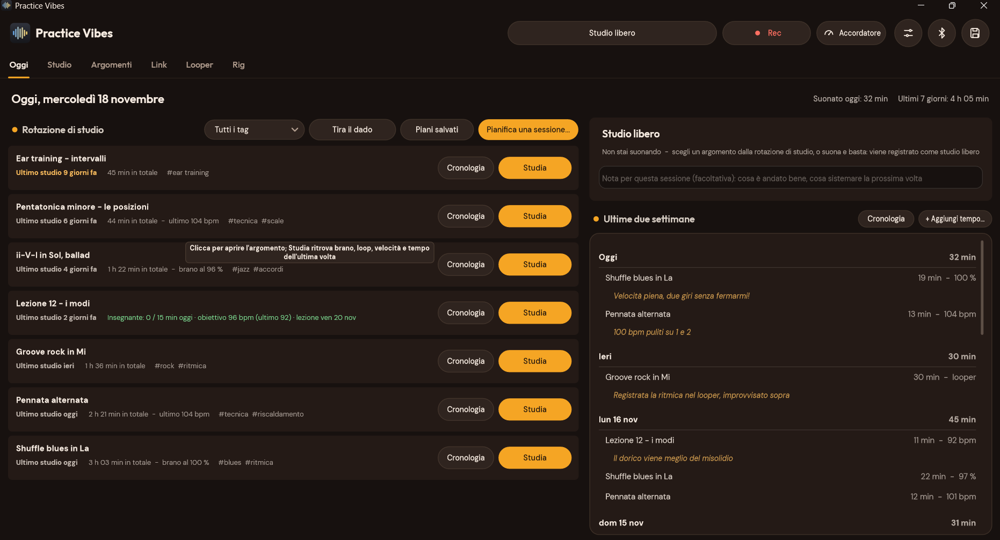
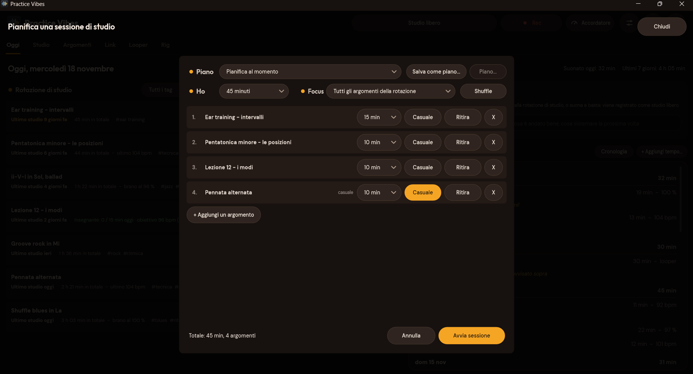
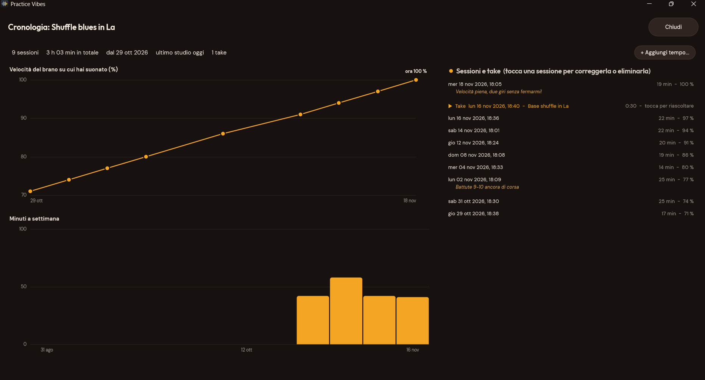

# 3. Oggi: il diario di studio e le sessioni

La scheda **Oggi** è la prima cosa che vedi quando apri l'app. L'idea è semplice: **l'app registra, tu suoni.** Non
avvii né fermi timer e non compili un diario. Suona, e il tempo viene annotato per te.

Niente serie da mantenere, niente promemoria, niente notifiche. È un diario con qualche aiuto, non un allenatore che
ti assilla.

---

## Come viene registrato quello che suoni

- L'app ascolta l'ingresso del tuo strumento (non serve che sia in monitor). Quando il livello è chiaramente sopra il
  rumore di fondo, stai **suonando**. Le brevi pause tra le frasi contano lo stesso; dopo circa **5 secondi di
  silenzio** il conteggio si ferma finché non riprendi.
- Il tempo va all'**argomento che stai studiando**. Un argomento diventa quello attuale quando:
  - premi **Studia** su di esso (scheda Oggi o scheda Argomenti), oppure
  - apri uno dei suoi brani, video o documenti.

  Se nessun argomento è attivo, il tempo viene registrato come **Studio libero**.
- Il **pulsante nella barra in alto** mostra sempre cosa stai studiando, con "(suonando)" davanti mentre ti sente.
  Toccalo per un menu: apri la scheda Oggi, smetti di studiare questo argomento, studia un altro argomento della
  rotazione, pianifica una sessione.
- Ogni voce annota anche il **tempo del metronomo** o la **velocità del brano** su cui hai suonato e se hai usato il
  **looper**. Questi dati alimentano i grafici dei progressi nella Cronologia.
- Le voci più brevi di **20 secondi** non vengono tenute, così due note di passaggio non riempiono il diario.
- **Aggiungi una nota** alla sessione in corso ("pulito a 90 bpm, il bending è ancora calante"). Viene salvata con la
  voce.

### Con il microfono integrato: Avvia e Pausa

Un microfono sente anche la stanza: voci, TV o strada verrebbero contate come se suonassi. Per questo, quando
l'ingresso dell'app è un microfono (quello dell'iPad o del portatile, un headset, un headset Bluetooth), l'app non
ascolta se suoni:
- La scheda Oggi mostra "Tempo non conteggiato (ingresso microfono)" e un pulsante **Avvia**. Tocca **Avvia** quando
  inizi; il conteggio va avanti finché non tocchi **Pausa**, che tu stia suonando o leggendo l'esercizio successivo.
- Ti sei dimenticato la pausa? Dopo **10 minuti** senza suoni il conteggio va in pausa da solo.
- Scegliere un altro argomento lascia il conteggio com'è (in corso o in pausa).

Con un'interfaccia audio (USB, o un driver ASIO su Windows) l'app conta da sola, come descritto sopra.

L'app indovina che tipo di ingresso hai. Per cambiarlo, apri le **Impostazioni audio** e scegli in **Diario di
studio**: **Automatico: conta il tempo in cui suono**, **Solo tra Avvia e Pausa (scheda Oggi)** o **Solo le note della
tastiera MIDI (ignora il suono)** (sezione successiva). La scelta vale solo per quell'ingresso: collega l'interfaccia e
torna a contare da sola.

> **Consiglio:** un'interfaccia audio resta la scelta migliore: tu suoni e l'app fa il resto.

### Con una tastiera MIDI

Collega una tastiera MIDI (USB, o Bluetooth MIDI sull'iPad) e le note che suoni contano come suonare, proprio come il
suono sull'ingresso: vale la stessa regola dei 5 secondi. Non serve un ingresso audio, e funziona anche accanto a uno
(per esempio l'uscita audio di un piano digitale nell'interfaccia *e* il suo cavo MIDI). Tenere il pedale di sustain o
girare manopole non conta, e le pressioni di un footswitch non contano mai.

Nelle **Impostazioni audio**:
- **Note MIDI**: **Da qualsiasi ingresso MIDI** (predefinito), **Solo da** un dispositivo (se anche altri dispositivi
  MIDI mandano note, per esempio un pad o un sequencer), oppure **Non contare le note MIDI**.
- **Diario di studio** › **Solo le note della tastiera MIDI (ignora il suono)**: per quando l'ingresso è un microfono
  nella stanza (altrimenti conterebbero anche le voci) ma suoni una tastiera MIDI. Contano solo le tue note, senza
  bisogno del pulsante Avvia.

Con un microfono e il conteggio predefinito Avvia / Pausa, le tue note MIDI evitano che il conteggio vada in pausa da
solo.

---

## La rotazione di studio

Non tutti gli argomenti vanno studiati con regolarità: alcuni sono materiale di consultazione. Quelli su cui vuoi
continuare a lavorare vanno nella **rotazione di studio**: apri l'argomento nella scheda **Argomenti** e attiva **Nella
rotazione di studio**.

Nella scheda Oggi, l'elenco **Rotazione di studio** mostra quegli argomenti, **prima quelli trascurati da più tempo**,
con quando li hai studiati l'ultima volta.

**Studia** riporta la configurazione con cui avevi lasciato l'argomento: il brano o il video, il loop A-B, la
velocità, il mix degli stem e il tempo del metronomo. Riprendi esattamente da dove avevi smesso. Un argomento non
ancora studiato apre il suo primo brano o video.

Se il tuo insegnante ti ha dato un compito su un argomento, la sua riga mostra quello al posto dei tuoi progressi, per
esempio "Insegnante: 5 / 15 min oggi · obiettivo 96 bpm (ultimo 88) · lezione ven 20 nov". Sta accanto al tuo piano e
non cambia nulla al suo interno (capitolo 9).

---

## Tira il dado

Non sai cosa studiare? **Tira il dado** sceglie a caso un argomento della rotazione. Più a lungo l'hai trascurato, più
è probabile che esca. Una striscia dice "Il dado dice: …", con **Studia** per cominciare. Tira di nuovo se la risposta
non ti piace.

Il **riquadro dei tag** accanto (**Tutti i tag**, o un tag come #tecnica) limita il dado e il piano di sessione agli
argomenti con quel tag.

---

## Pianifica una sessione

Per una sessione strutturata: **Pianifica una sessione...**

1. Scegli quanto tempo hai (**Ho** da 15 minuti a 2 ore) e, se vuoi, un tag di **Focus**.
2. L'app propone da 3 a 5 **spazi**: argomenti diversi della rotazione con i loro minuti, preferendo quelli trascurati.
3. Sistemalo:
   - cambia i minuti di uno spazio,
   - **Ritira** uno spazio (un altro argomento),
   - **X** toglie uno spazio, **+ Aggiungi un argomento** ne aggiunge uno (tira il dado o scegli per nome),
   - **Shuffle** rifà tutto il piano.
4. **Avvia**.

Mentre la sessione è in corso:
- Il primo argomento si apre con la sua ultima configurazione. La **barra in alto** mostra "1/4 Argomento – 14:59", e
  la scheda Oggi mostra la sessione con tutti i suoi spazi.
- **Il tempo dello spazio scorre solo mentre suoni.** Subito dopo Avvia aspetta; rispondi al telefono e si ferma;
  riprendi a suonare e riparte. "15 minuti" significa quindici minuti suonati davvero.
- Quando il tempo è scaduto senti **un rintocco leggero** e la barra in alto diventa ambra: "Tempo scaduto - prossimo:
  …". Non si passa oltre da soli: finisci la frase, poi scegli **Prossimo argomento**, o **+5 min** se ne vuoi ancora.
  Le stesse scelte sono nel menu del pulsante nella barra in alto.
- Sull'ultimo spazio, **Concludi** mostra un riepilogo ("Sessione finita: 45 min, 4 argomenti"). **Termina** si ferma
  prima, con lo stesso riepilogo per quello che hai fatto.

---

## Piani salvati

Se una sessione ti piace, tienila: nel piano, **Salva come piano...** e dagli un nome (per esempio "Riscaldamento del
mattino").

- **Piani salvati** (nella scheda Oggi, accanto a Pianifica una sessione) elenca i tuoi piani:
  - **Avvia** lo esegue così com'è.
  - **Cambia per oggi...** lo apre nel piano di sessione. Le modifiche valgono solo per oggi; il piano salvato resta
    com'era. Per tenerle, usa **Salva come piano...** › **Salva le modifiche a "…"** (o **Salva come nuovo piano...**).
- **Spazi casuali**: attiva **Casuale** su uno spazio e, in un piano salvato, ogni volta sceglie un argomento diverso
  della rotazione (o uno a caso con il tag di Focus). Ottimo per "un argomento trascurato" alla fine di una routine.
- **Piano...** › **Rinomina...**, **Duplica**, **Elimina...** per gestire i piani.
- Se cancelli un argomento usato da un piano, il suo spazio appare come *Argomento mancante* e viene saltato.
  Ritiralo o toglilo.

I piani sono salvati nella cartella della libreria, quindi sono su tutti i tuoi dispositivi se la libreria è
condivisa.

---

## Cronologia e progressi

- **Cronologia** su un argomento (dalla rotazione in Oggi, o dalla pagina dell'argomento in Argomenti): tempo totale e
  sessioni, una linea del **tempo** e/o della **velocità del brano** su cui hai suonato nel tempo, i **minuti a
  settimana** delle ultime 12 settimane e ogni sessione con le sue note e i suoi take.
- **Cronologia** nella scheda Oggi (accanto a Ultime due settimane): lo stesso per tutti gli argomenti, più il **tempo
  per argomento**. Tocca la barra di un argomento per la sua Cronologia.

---

## Correggere il diario

- **iPad in verticale:** la rotazione e **Ultime due settimane** si alternano. **Mostra** accanto a Ultime due
  settimane mette l'elenco al posto della rotazione; **Nascondi** riporta la rotazione.
- **Una voce sbagliata?** Toccala, in **Ultime due settimane** o in una Cronologia, per cambiarne argomento, ora di
  inizio, minuti o nota, oppure **Elimina voce**. Totali e grafici si aggiornano, su tutti i dispositivi.
- **Studio libero che in realtà era un argomento?** Tocca la voce e scegli l'argomento nel menu **Argomento**.
  Funziona anche al contrario: sposta una voce su un altro argomento, o di nuovo in **Studio libero**.
- **Hai studiato senza l'app?** **+ Aggiungi tempo...** (scheda Oggi o Cronologia di un argomento): scegli l'argomento
  (o Studio libero), l'inizio, i minuti e una nota. La voce viene segnata come "aggiunta a mano".

---

## Studiare senza suonare

Per ear training, teoria o lettura non c'è niente da "sentire". Attiva **A tempo senza suonare** su quell'argomento
(scheda Argomenti). Quando lo studi, il conteggio parte appena l'argomento è attivo, che tu suoni o no:
- La scheda Oggi mostra "Conteggio in corso (senza suonare)" con **Pausa** / **Riprendi** per le pause, e **Stop**
  quando hai finito.
- Se ti dimentichi di fermarlo, correggi la voce dopo (vedi Correggere il diario).

Le sue voci sono segnate come "tempo d'orologio" e contano nei totali come qualsiasi altro tempo.

Avanti: **[4. Il lettore](04-player.md)**: rallenta, metti in loop e scomponi un brano.
