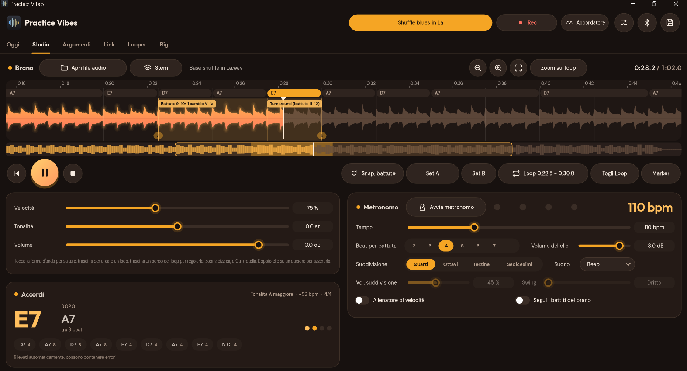
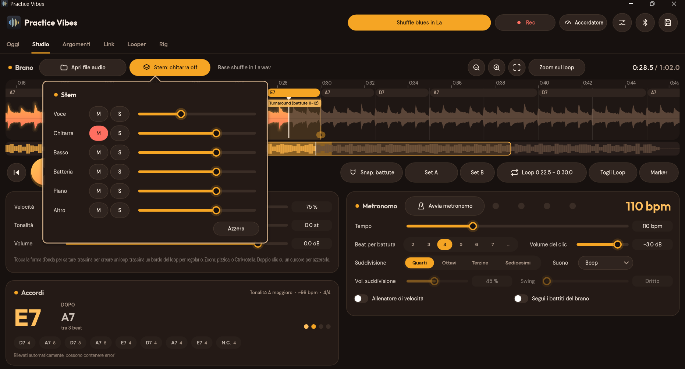

# 4. Il lettore: rallenta, metti in loop, scomponi

La scheda **Studio** è dove suoni insieme ai brani. Carica un brano, rallentalo, metti in loop il passaggio difficile,
silenzia la chitarra della registrazione e suonala tu.

---

## Caricare un brano

- **Apri file audio** (icona della cartella) e scegli un file: WAV, AIFF, FLAC, MP3 o M4A.
- Oppure apri un brano da un **argomento** (scheda Argomenti): si carica qui, e quell'argomento diventa quello che stai
  studiando.
- **Windows**: clic destro su un brano in Esplora file › **Apri con** › **Scegli un'altra app**, poi cerca Practice
  Vibes.exe. **Mac**: clic destro su un brano nel Finder › **Apri con** › **Practice Vibes**.

Se il brano non è nella tua libreria, l'app chiede **"Aggiungere alla libreria?"**. **Aggiungi a In arrivo** lo copia
nella cartella In arrivo della libreria (l'originale resta dov'era), così è anche sugli altri dispositivi e tiene i
suoi stem accanto. **Non ora** lo riproduce e basta.

Mentre un brano si carica, l'app ne ricava anche accordi, beat e battute ("Analisi degli accordi..."). Vedi il
capitolo 5.

---

## Riprodurre

- Il grande pulsante tondo **Play** (o la **barra spaziatrice**) avvia e mette in pausa. I pulsanti accanto tornano
  **all'inizio** e **fermano**.
- **Tocca la forma d'onda** per saltare in quel punto.
- **Volume** regola il livello del brano rispetto al tuo strumento.

---

## Velocità e tonalità

- **Velocità** 25–150 %: rallenta o accelera il brano **senza cambiarne l'intonazione**. Parti piano (per esempio 70 %)
  e sali.
- **Tonalità** ±12 semitoni: cambia la tonalità **senza cambiare la velocità**. Utile per un brano registrato in
  un'accordatura diversa dalla tua (per esempio −1 per un brano accordato mezzo tono sotto), o per studiare in un'altra
  tonalità. Si muove a passi di 0,1, quindi puoi anche correggere una registrazione leggermente fuori dal La di
  riferimento.
- **Doppio tocco su un cursore** per riportarlo al valore iniziale (100 %, 0 semitoni).

---

## Il loop A-B

Metti in loop una sezione e suonala ancora e ancora:
- **Trascina sulla forma d'onda** da dove deve iniziare il loop a dove deve finire. Oppure riproduci il brano e tocca
  **Set A** all'inizio e **Set B** alla fine.
- **Trascina un bordo del loop** per regolarlo.
- Il pulsante **Loop** (mostra i tempi del loop) accende e spegne il loop senza perderlo. **Togli Loop** lo elimina.

Lo **Snap** fa cadere i bordi del loop esattamente sulle battute o sui beat del brano, così il loop si ripete a tempo.
Tocca il pulsante per passare tra **Snap: battute** › **Snap: beat** › **Snap: off**. Funziona perché l'app ha
riconosciuto i beat (capitolo 5); per un brano a tempo libero, spegnilo.

Per tenere un loop per dopo, con la sua velocità e tonalità, usa **Marker** > **Salva questo loop**; **Marker** mette
anche segnaposti con un commento sul brano (capitolo 9).

---

## Zoom

Per punti di loop precisi, ingrandisci la forma d'onda:
- **iPad**: pizzica con due dita, trascina per spostarti lungo il brano.
- **Windows**: Ctrl + rotellina ingrandisce intorno al puntatore; la rotellina da sola scorre.
- **Mac**: pizzica sul trackpad o Cmd + rotellina; lo scorrimento con due dita scorre.
- I pulsanti **−** / **+** riducono e ingrandiscono, **Adatta** mostra tutto il brano, **Zoom sul loop** riempie la
  vista con il loop.
- La striscia sottile sotto la forma d'onda mostra tutto il brano con la parte che stai guardando; toccala o
  trascinala per spostarti.

---

## Video di YouTube

Un link di YouTube in un argomento o nella scheda Link apre il video **dentro l'app**, nella scheda Studio al posto
della forma d'onda. Hai gli stessi strumenti di studio:
- una linea del tempo per spostarti e trascinare un **loop A-B**,
- **velocità** (i passi di YouTube, per esempio 0,5×, 0,75×, 1×) e **volume**.

Tonalità, stem e riconoscimento degli accordi non funzionano con i video. Solo con i file audio.

Quando passi a un'altra scheda mentre un video è in riproduzione, si rimpicciolisce in un **lettore compatto** che
galleggia sopra l'app; trascinalo dove vuoi, **ingrandiscilo** per tornare, o chiudilo. **Lettore compatto** nella
scheda Studio lo rimpicciolisce a mano; **Chiudi video** torna al lettore dei brani.

> Alcuni video non si possono riprodurre fuori da YouTube (lo vieta il proprietario). In quel caso ricevi un messaggio
> e un pulsante per aprirlo su YouTube. **iPad**: la primissima riproduzione di un video può richiedere un tocco sul
> video stesso (una regola di iPadOS).

---

## Stem: silenzia la tua parte nel disco

**Stem** divide un brano in sei parti: **voce, chitarra, basso, batteria, piano** e **altro**. Poi puoi silenziare la
chitarra registrata (o il basso, o il piano) e suonare la parte tu, ascoltare solo basso e batteria per agganciarti
alla sezione ritmica, o abbassare la voce.

1. Carica un brano e tocca **Stem** (accanto ad Apri file audio) › **Separa stem**.
2. Solo la prima volta, l'app scarica il modello di separazione (115 MB).
3. La separazione avviene in sottofondo: circa **3 minuti per un brano di 4** su un portatile normale. Puoi chiudere la
   finestra e continuare a studiare; il pulsante Stem mostra l'avanzamento.
4. Quando ha finito, la finestra diventa un **mixer**: per ogni stem, **M** (muto), **S** (solo: suonano solo gli stem
   in solo) e un cursore del volume. Il pulsante Stem mostra il tuo mix, per esempio "Stem: chitarra spenta".

- Velocità, tonalità, loop e metronomo continuano a funzionare con gli stem.
- Gli stem vengono salvati accanto al brano (circa 30 MB ogni 4 minuti), quindi un brano si separa una volta sola, e
  tornano da soli la volta dopo che lo apri.
- **Studia** su un argomento riporta il suo mix degli stem.
- Un footswitch può silenziare e riattivare uno stem a tua scelta (capitolo 11).
- Gli stem vecchi si possono togliere in **Spazio e pulizia** (capitolo 9). Si possono sempre rifare.

> **iPad:** la separazione richiede l'app per Windows o Mac (è troppo pesante per l'iPad). Se la tua libreria è
> condivisa tramite iCloud Drive, i brani separati sul computer hanno i loro stem anche sull'iPad.

> La separazione è molto buona ma non perfetta: una chitarra silenziata può lasciare un leggero "fantasma", e strumenti
> simili (per esempio due chitarre, o una chitarra e una tastiera) possono finire nello stesso stem.

Avanti: **[5. Accordi, beat e metronomo](05-chords-metronome.md)**
