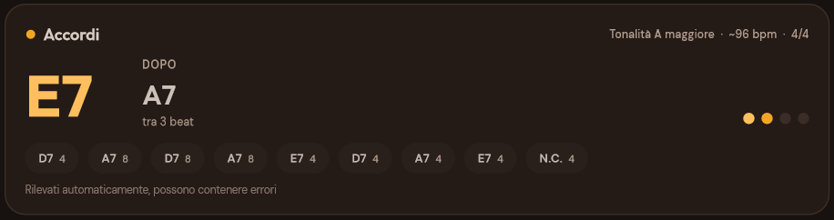

# 5. Accordi, beat e metronomo

---

## Riconoscimento degli accordi

Quando carichi un brano, l'app lo ascolta e ne ricava **accordi**, **beat**, **battute** e **tempo in chiave**. Ci
vogliono pochi secondi ("Analisi degli accordi...").

- Il riquadro **Accordi** nella scheda Studio mostra in grande l'accordo che suona ora, quello **DOPO** e fra quanti
  beat arriva, e gli accordi successivi. Dei pallini si accendono per ogni beat dell'accordo attuale. Tonalità, tempo e
  tempo in chiave del brano sono in alto a destra.
- La **corsia degli accordi** sopra la forma d'onda mostra tutti gli accordi lungo il brano, con quello attuale
  evidenziato. Comoda per vedere dove cambiano quando imposti un loop.
- Anche gli **accordi con basso** sono riconosciuti (D/F# = un accordo di Re con il Fa# al basso).
- Tempi in chiave: 3/4, 4/4, 5/4 e 7/4, compresi i cambi a metà brano.
- Gli accordi seguono il brano quando cambi velocità o tonalità (con la tonalità spostata, vedi gli accordi come li
  senti).

> È una stima automatica, quindi prendila come un punto di partenza utile, non come una trascrizione. Arrangiamenti
> densi e accordi insoliti possono uscire semplificati, e "troverà" accordi perfino in un assolo di batteria o nel
> parlato. Se una sezione ti suona sbagliata, fidati delle tue orecchie.

---

## Il metronomo

Il metronomo è nella scheda Studio. **Avvia metronomo** lo fa partire; continua anche nelle altre schede.

- **Tempo** 30–300 bpm.
- **Beat per battuta**: tocca un numero (da 2 a 7, o **…** per gli altri). Il primo beat della battuta è accentato.
- **Suono**: **Beep**, **Clic** o **Batteria** (cassa sul primo beat, rullante sul 2 e sul 4, charleston sulle
  suddivisioni).
- **Volume del clic** regola il livello del metronomo.

### Suddivisioni e swing
- **Suddivisione**: **Quarti**, **Ottavi**, **Terzine** o **Sedicesimi**. I clic in più sono più leggeri dei beat, e
  **Vol. suddivisione** regola quanto.
- **Swing** (ottavi e sedicesimi): scorri da **Dritto** a **Shuffle** a **Puntato**. Serve per studiare shuffle blues e
  feeling swing.

### Allenatore di velocità
Aumenta la velocità poco alla volta, senza che tu tocchi niente:
1. Imposta il tempo di partenza.
2. Attiva l'**Allenatore di velocità**: sotto compaiono le sue impostazioni. **Aggiungi** 2 bpm **ogni** 4 **battute**
   (o minuti), **fino a** per esempio 120 bpm. (Si nascondono di nuovo quando spegni l'allenatore.)
3. Avvia il metronomo e suona. Il tempo sale da solo fino all'obiettivo.

Il tuo tempo migliore viene salvato nel diario di studio dell'argomento e compare nel grafico della sua Cronologia
(capitolo 3).

### Segui i battiti del brano
**Segui i battiti del brano** fa suonare il metronomo insieme al **brano**, sui beat riconosciuti dall'app, invece che a
un tempo fisso. Utile per:
- sentire chiaramente il beat in un brano con un ritmo sciolto o difficile da seguire,
- brani che accelerano o rallentano (registrazioni dal vivo),
- tenere il clic a tempo quando rallenti il brano o lo metti in loop.

Serve un brano caricato. Mentre il looper ha dei loop, tempo e metrica sono bloccati (capitolo 7).

Le impostazioni restano tra una sessione e l'altra. **Studia** su un argomento riporta il tempo che avevi usato
l'ultima volta.

Avanti: **[6. Registrare take](06-takes.md)**
