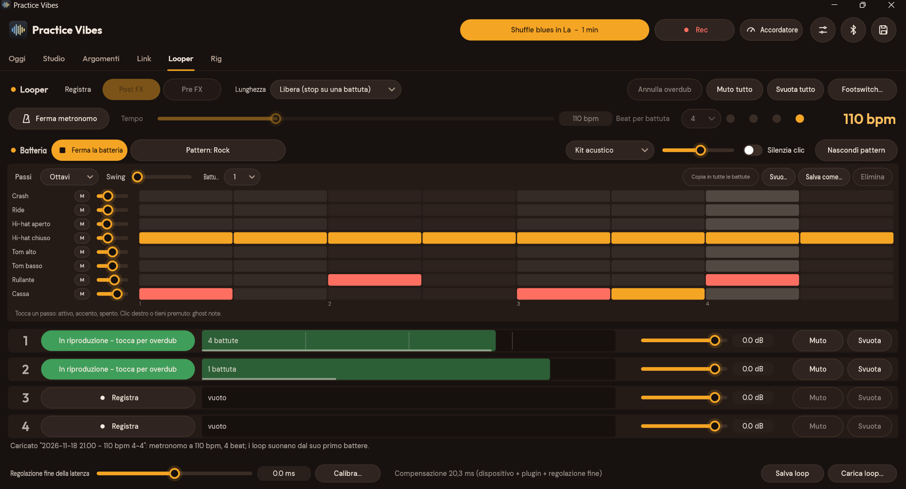

# 7. Looper e drum machine

La scheda **Looper** registra brevi loop di quello che suoni e li ripete, così puoi suonare sopra i tuoi accordi,
costruire strati o studiare l'improvvisazione su un giro. Una drum machine integrata suona insieme, a tempo.

---

## Come il looper tiene il tempo

Il looper è agganciato al **metronomo**. I loop durano un numero intero di **battute** al tempo e alla metrica del
metronomo, e ogni traccia parte su una battuta. Per questo i loop non si sfasano mai, e la drum machine ci sta sempre
dentro.

Quindi: **imposta prima il tempo e i beat per battuta** (nella scheda Looper, o nel metronomo della scheda Studio).
Quando ci sono dei loop, tempo e metrica restano bloccati finché non li svuoti.

---

## Registrare un loop

Ci sono **4 tracce**. Ognuna ha un grande pulsante che fa tutto:

1. **Registra**: toccalo. Il metronomo parte se serve; la traccia mostra "In attesa della battuta..." e la
   registrazione comincia alla battuta successiva.
2. Suona. **Lunghezza** decide quando si ferma:
   - **1–16 battute**: si ferma da sola dopo quelle battute e comincia a suonare.
   - **Libera (stop su una battuta)**: tocca di nuovo quando hai finito; si ferma alla fine della battuta in corso.
3. **In riproduzione - tocca per overdub**: tocca per registrare un altro strato sulla stessa traccia; tocca di nuovo
   per smettere.
4. **Annulla overdub** toglie l'ultimo strato.

Ogni traccia ha anche **Muto** / **Attiva** e **Svuota**. **Muto tutto** e **Svuota tutto** agiscono su tutte le
tracce. Le tracce possono avere lunghezze diverse (per esempio un loop di accordi di 4 battute e un riff di 1 battuta);
restano a tempo tra loro. Una traccia contiene fino a 60 secondi.

- Sul computer, i tasti **1**–**4** premono i pulsanti delle tracce.
- Un footswitch è molto più comodo che toccare lo schermo con lo strumento in mano (capitolo 11).
- I loop continuano a suonare quando passi alle altre schede.

---

## Prima o dopo gli effetti

**Registra: Post FX / Pre FX** decide cosa cattura un loop:
- **Post FX** (predefinito): il tuo strumento come lo senti, con gli effetti del rig. Se poi cambi suono, il loop
  tiene quello vecchio: per esempio un loop ritmico pulito, poi un assolo distorto sopra.
- **Pre FX**: il tuo strumento senza effetti. I loop vengono suonati attraverso il rig, quindi cambiando gli effetti
  cambiano anche i loop. Utile per provare suoni diversi sulla stessa parte.

La scelta è bloccata finché ci sono dei loop.

---

## Compensazione della latenza

> **Come funziona.** Quello che suoni arriva all'app con qualche millisecondo di ritardo (la latenza del capitolo 2), e
> anche i loop li senti con qualche millisecondo di ritardo. Senza una correzione, ogni overdub cadrebbe un po' dietro
> il beat e gli strati suonerebbero "sbavati". Il looper lo corregge con quello che dichiara il dispositivo audio, ma
> alcuni dispositivi non lo dichiarano con precisione.

Per controllarlo una volta:
1. **Calibra...** nella scheda Looper.
2. Suona **note brevi e smorzate** **esattamente sui clic**, 12 volte: sulla chitarra, una pennata con le corde
   stoppate dalla mano sinistra; sulla tastiera, note brevi staccate; sulla batteria, un colpo sul cerchio.
3. L'app misura quanto arrivano in ritardo e imposta la compensazione. Il valore compare in basso ("Compensazione …").

**Regolazione fine della latenza** ti permette di correggerla a mano se gli overdub sembrano ancora in anticipo o in
ritardo. Rifai la calibrazione dopo aver cambiato interfaccia audio o dimensione del buffer.

---

## Salvare i loop

- **Salva loop** conserva la sessione: un file WAV per traccia più un mix di tutte, il tempo e la metrica, e il
  pattern di batteria. Si salva in Documenti › Practice Vibes › Loops (iPad: File › Practice Vibes › Loops); **Mostra
  la cartella Loops** la apre sul computer. I file WAV si aprono con qualsiasi app audio.
- **Carica loop...** riporta una sessione (il looper dev'essere vuoto: prima **Svuota tutto**). Il metronomo prende il
  tempo e la metrica della sessione.

---

## Drum machine

La riga **Batteria** nella scheda Looper suona un pattern di batteria a tempo con i loop, ma non viene registrata
dentro di essi.

- **Suona la batteria** avvia il pattern (e il metronomo, se serve); **Ferma la batteria** lo ferma.
- **Pattern**: scegli uno dei 13 **Pattern di partenza** (da "Cassa sul beat" e "Ritmo base" passando per Rock, Funk,
  Shuffle, Slow blues, Jazz swing, Reggae e Bossa nova fino a "Valzer (3/4)" e "Ballata (6/8)") o uno dei **I miei
  pattern**. Un pattern in un'altra metrica cambia il metronomo di conseguenza.
- **Kit**: **Kit acustico** (una batteria registrata) o **Kit elettronico** (una drum machine).
- **Volume batteria**, e **Silenzia clic** per zittire il metronomo mentre la batteria tiene il tempo.
- Il pattern riparte dalla sua prima battuta con il tuo primo loop, così un fill sulla battuta 4 di un pattern di 4
  battute cade alla fine di un loop di 4 battute.

### Modificare un pattern
**Modifica pattern** mostra la griglia (**Nascondi pattern** la nasconde di nuovo per fare spazio):
- Righe: crash, ride, hi-hat aperto, hi-hat chiuso, due tom, rullante, cassa. Colonne: i passi di una battuta.
- Tocca un passo: **acceso** → **accento** → **spento**. Clic destro (iPad: tieni premuto) per una **ghost note**
  leggera.
- **Passi**: Ottavi, Terzine o Sedicesimi; **Swing** per un feeling shuffle.
- **Battute**: 1, 2, 4 o 8, con una linguetta per battuta; **Copia in tutte le battute**, **Svuota** (la battuta
  visualizzata).
- Ogni pezzo della batteria ha il suo muto e il suo volume.
- **Salva come...** lo conserva con un nome in I miei pattern (Documenti › Practice Vibes › Drum patterns).

Avanti: **[8. Accordatore](08-tuner.md)**
