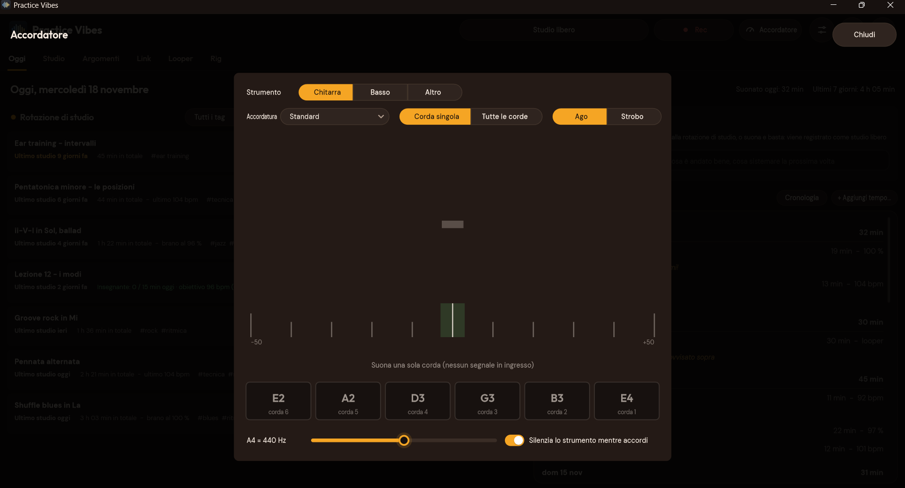

# 8. Accordatore

Tocca **Accordatore** nella barra in alto (o usa un footswitch). L'accordatore si apre sopra quello che stai facendo;
chiudilo per tornare indietro.

---

## Scegli il tuo strumento

**Strumento** in alto: **Chitarra**, **Basso** o **Altro**.
- **Chitarra** e **Basso** mostrano una fila di corde per la tua accordatura, e possono controllare tutte le corde
  insieme.
- **Altro** è un semplice accordatore cromatico per tutto il resto (tastiera, violino, fiati, la tua voce): mostra la
  nota che suoni e quanto è lontana, senza corde.

Ogni strumento tiene la sua accordatura, quindi passare da chitarra a basso non fa perdere nulla.

---

## Accordare una corda alla volta

1. **Corda singola** (predefinita). Suona una corda a vuoto (o una nota) e lasciala suonare.
2. L'accordatore mostra la **nota** e l'ottava, e quanto è lontana in **cent** (un cent è 1/100 di semitono).
   - Ago a sinistra = **calante** (troppo bassa): tendi la corda. Ago a destra = **crescente** (troppo alta):
     allentala.
   - **Verde** = accordata (entro 3 cent).
3. La fila di corde mostra la tua accordatura; si accende la corda più vicina. Se sei molto lontano dice per esempio
   "2 st calante" (2 semitoni), così sai da che parte girare.

**Silenzia lo strumento mentre accordi** zittisce il tuo strumento in cuffia mentre l'accordatore è aperto.

---

## Ago o strobo

- **Ago**: la vista classica, utile per avvicinarsi in fretta.
- **Strobo**: una fascia che scorre a sinistra quando sei calante e a destra quando sei crescente, e **sta ferma**
  quando sei esattamente intonato. Più lenta si muove, più sei vicino. La migliore per l'ultimo cent o due.

---

## Altre accordature

**Accordatura** sceglie cosa seguono la fila di corde e la "corda più vicina":
- **Chitarra**: Standard, Mezzo tono sotto, Un tono sotto, Drop D, Drop C, DADGAD, Open G, Open D, Open E, Open C.
- **Basso**: Standard, Mezzo tono sotto, Un tono sotto e Drop D per 4 corde; Standard (Si basso) e C acuto per
  5 corde; Standard per 6 corde.

Per tutto il resto, **tocca una corda** nella fila e scegli la sua nota: così crei un'accordatura **Personalizzata**.
La tua scelta viene ricordata.

---

## Tutte le corde

Un controllo veloce di tutta la chitarra o il basso:
1. **Tutte le corde**.
2. Fai una pennata sulle corde a vuoto e lasciale suonare.
3. Dopo circa mezzo secondo, ogni corda mostra **accordato**, **calante** o **crescente**, tutte insieme. Una corda che
   l'accordatore non è riuscito a sentire dice "non sentito".

Sistema quelle fuori (in modalità Corda singola, o semplicemente a orecchio), poi rifai la pennata per controllare.

---

## La di riferimento

**A4 =** imposta il riferimento: 440 Hz è lo standard. Scegli tra 430 e 450 Hz per adattarti a un pianoforte, a una
registrazione o a una band che accorda diversamente. Doppio tocco sul cursore per tornare a 440.

Avanti: **[9. Argomenti e Link](09-topics-links.md)**
