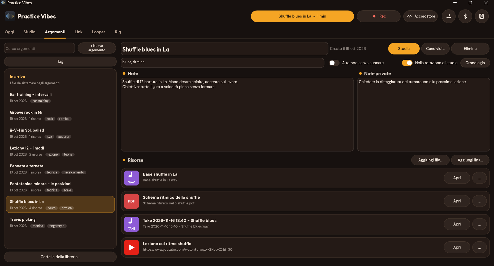

# 9. Argomenti e Link

Gli **Argomenti** sono dove vive il tuo materiale di studio: lezioni, brani, tecniche, esercizi. **Link** è un elenco
separato di siti utili.

---

## Cos'è un argomento?

Un argomento è qualsiasi cosa tu studi: "Pennata alternata", "Autumn Leaves", "Lezione 12 – i modi". Ogni argomento ha:
- un **titolo** e dei **tag** (per esempio tecnica, jazz, lezione): servono per la ricerca, il dado e il piano di
  sessione,
- **Note**: cosa studiare, come, cosa ha detto il tuo insegnante. Si salvano mentre scrivi,
- **Risorse**: i brani, PDF, immagini, video e link che vanno con l'argomento, nell'ordine che scegli tu,
- **Nella rotazione di studio**: lo mette nell'elenco della scheda Oggi (capitolo 3),
- **A tempo senza suonare**: per ear training o teoria (capitolo 3),
- i pulsanti **Cronologia** e **Studia**.

---

## Creare e riempire gli argomenti

1. **+ Nuovo argomento**, scrivi un titolo. Aggiungi i tag sotto il titolo, separati da virgole.
2. **Aggiungi file...** copia documenti, immagini o file audio nell'argomento. Sul computer puoi anche **trascinare i
   file** da Esplora file o dal Finder sull'argomento.
3. **Aggiungi link...** aggiunge un video di YouTube, un documento Google o qualsiasi pagina web.
4. Il menu **…** di ogni risorsa: **Modifica titolo e descrizione...** (e tag), **Sposta su** / **Sposta giù**,
   **Mostra nella cartella**, **Rimuovi**.

Aprire una risorsa:
- I **brani** si aprono nel lettore (scheda Studio); i link di **YouTube** nel lettore video dell'app.
- **PDF, immagini, testi e video** si aprono in un visualizzatore dentro l'app.
- Le **pagine web** si aprono nel tuo browser.
- Gli altri file (per esempio documenti Word) si aprono con la loro app sul computer. **Apri fuori dall'app** è sempre
  nel menu **…**.

Aprire qualcosa da un argomento lo rende l'argomento che stai studiando, così il tempo che suoni va a lui.

---

## Trovare le cose

- **Cerca argomenti**: scrivi l'inizio di una parola. Trova gli argomenti per titolo, e anche per i nomi, i tag e le
  note al loro interno (l'elenco dice dove ha trovato la corrispondenza, per esempio "nelle note").
- **Tag**: mostra solo gli argomenti con un certo tag.
- **Elimina** (nella pagina dell'argomento) sposta la sua cartella nel Cestino. Sull'iPad viene eliminato per sempre.

---

## In arrivo

**In arrivo** raccoglie i file che non sono ancora in un argomento: brani aggiunti da altre parti ("Aggiungi a In
arrivo"), take registrati in studio libero, file messi nella cartella della libreria da un altro dispositivo. Usa
**Sposta nell'argomento...** per sistemare ognuno.

---

## La cartella della libreria e la condivisione tra dispositivi

Tutto quello che c'è qui sopra è salvato come normali file nella tua **cartella della libreria** (scelta nel
capitolo 2): una cartella per argomento, con i suoi file e un piccolo topic.xml. Puoi sfogliarla con Esplora file, il
Finder o l'app File, e farne un backup come qualsiasi cartella. **Cartella della libreria...** › **Mostra la cartella**
la apre (sul computer).

Se la libreria è in **iCloud Drive** (o, solo tra computer, in un'altra cartella sincronizzata), tutti i tuoi
dispositivi condividono: argomenti, brani, take, stem, diario di studio, piani salvati e link. Le modifiche fatte su un
altro dispositivo compaiono dopo che il cloud ha sincronizzato, di solito entro un minuto. **Cartella della
libreria...** › **Controlla subito le modifiche** guarda subito.

> **Modificato su due dispositivi insieme?** Il cloud può tenere due copie di un argomento. L'argomento mostra allora
> "La sincronizzazione cloud ha creato una copia in più" con **Scegli versione...**: scegli quella da tenere; l'altra va
> nel cestino.

> **iPad e il cloud:** i file che sono solo "nel cloud" vengono scaricati in sottofondo, quindi una libreria grande può
> metterci un minuto o due a riempirsi la prima volta.

---

## Condividere un argomento con un insegnante, un allievo o un compagno di band

**Condividi...** (accanto a **Studia**) impacchetta l'argomento in un unico file che puoi mandare con AirDrop, Mail,
WhatsApp o Messaggi.

1. **Invia come**: **Argomento Practice Vibes** se l'altra persona ha l'app; **Documento per tutti** se non ce l'ha
   (una pagina web con le note, i link e i file: si apre su qualsiasi telefono o computer e si può stampare).
2. Spunta i file da includere. Le tue registrazioni e i tuoi documenti sono spuntati; i brani no, perché possono essere
   registrazioni commerciali: l'altra persona usa la sua copia. Il totale ti dice se ci sta in una mail.
3. **Condividi...**: sull'iPad si apre il foglio di condivisione. Sul computer il file viene mostrato nella sua
   cartella: trascinalo nella tua mail o chat.

Le note, i link e i dettagli delle risorse viaggiano sempre. Le tue **Note private** (accanto a Note) e il tuo diario
di studio mai.

**Ricevere un argomento**: tocca il file in Mail, WhatsApp o File e scegli Practice Vibes (sul computer, fai doppio
clic, oppure **Cartella della libreria...** › **Importa un argomento condiviso**). Prima vedi cosa succederà:
- un **nuovo argomento**, oppure **aggiorna il tuo argomento** se ce l'hai già (per esempio il tuo insegnante ti ha
  mandato la versione di questa settimana): le nuove risorse e le note cambiate vengono aggiunte, le tue note private
  restano come sono. **Importa come copia** lascia intatto il tuo.
- i brani esclusi da chi l'ha inviato vengono cercati nella tua libreria, se li hai (stesso nome di file). Se no,
  **Individua...** ti permette di indicare la tua copia, oppure il brano resta elencato come mancante.

## Marker: segnaposti e loop salvati

Mentre suona un brano di un argomento, **Marker** (accanto a **Togli Loop**) ti permette di:
- **aggiungere un marker** nel punto attuale, con un breve commento ("parte l'assolo", "battuta 17: attenzione alla
  diteggiatura"),
- **Salva questo loop**: il loop A-B insieme alla sua velocità e tonalità,
- tornare a uno qualsiasi di questi: un loop salvato riporta anche la sua velocità e tonalità.

Compaiono sulla forma d'onda come piccole bandierine. Con un take aperto, **Marker** aggiunge commenti in un punto del
take ("1:23 qui corri"): comodo per un insegnante che ascolta il take di un allievo. I marker sono salvati
nell'argomento, quindi viaggiano con lui quando lo condividi.

## Modalità lezione

Insegnanti: attivate **Insegno** nelle impostazioni (icona dell'ingranaggio, Schermo). Nella barra in alto compare un
pulsante **Lezione**. Toccalo quando comincia una lezione: l'app funziona come sempre (scegli un argomento, suona un
brano, fai un loop) ma niente finisce nel tuo diario di studio. Toccalo di nuovo quando la lezione è finita. L'app
parte sempre con la modalità lezione spenta, così una lezione che ti sei dimenticato di chiudere non si mangia il tuo
studio del giorno dopo.

Quando chiudi una lezione, l'app propone di mandare l'argomento al tuo allievo. I take che registri durante una lezione
si chiamano "Demo ..." così il tuo allievo li distingue dai suoi.

Con **Insegno** attivo hai anche:
- **Compito...** su ogni argomento: un obiettivo, un tempo da raggiungere, minuti al giorno e la prossima lezione.
  Viaggia con l'argomento e compare nella scheda Oggi del tuo allievo ("Insegnante: 5 / 15 min oggi").
- un riquadro **Allievo** (un nome o un soprannome: resta sui tuoi dispositivi e non viene mai inviato), e un elenco
  **Allievi** nel menu **Tag** per vedere gli argomenti di un allievo.
- **Come nuovo argomento** nella finestra di condivisione: la stessa lezione per un altro allievo, come sua copia
  separata. È spuntato per i tuoi argomenti di lezione, e non spuntato per un argomento che appartiene già a un
  allievo (in quel caso stai rispondendo, e la sua copia viene aggiornata). La riga sotto dice cosa succederà.
- **Gruppi** per gli ensemble: **Tag** › **Nuovo gruppo (ensemble)...**, dagli un nome e i suoi membri (nomi o
  soprannomi). Nella finestra di condivisione scegli il gruppo in **A**: **un solo file per tutto il gruppo** (mandalo
  una volta nella chat del gruppo) o **un file per membro** (sull'iPad e sul Mac un elenco mostra allora ogni membro con
  il suo pulsante **Condividi...**, così ogni file va nella chat giusta). Quando i membri rimandano la loro copia,
  l'app chiede **Chi l'ha inviato?** (prova a indovinare dal nome che hanno scritto) e tiene la copia di ogni membro
  come argomento a sé. L'argomento che hai mandato dice chi ha già rimandato qualcosa e chi non ancora. I gruppi
  restano sui tuoi dispositivi, come il riquadro Allievo.

Gli allievi possono spuntare **Includi il mio studio su questo argomento** quando rimandano un argomento: l'insegnante
vede i totali (tempo a settimana, tempo del metronomo, giorni di fila), nient'altro dal loro diario.

---

## Spazio e pulizia

Take, stem e loop salvati si accumulano. **Cartella della libreria...** › **Spazio e pulizia...** mostra quanto spazio
usa ogni tipo di cosa, ed elenca cosa si può togliere:
- take, sessioni di loop salvate, stem (si possono rifare) e la cache del visualizzatore web,
- **Selezione rapida...**: per esempio take più vecchi di una settimana / un mese / 3 mesi, loop salvati più vecchi di
  un mese,
- **Rimuovi selezionati**: sul computer gli elementi vanno nel Cestino; sull'iPad vengono eliminati per sempre.

I tuoi brani e documenti non vengono mai proposti per la rimozione.

---

## Link

La scheda **Link** è un elenco di segnalibri per i siti su cui torni spesso: una spiegazione del circolo delle quinte,
un cerca-scale, un dizionario di accordi…

- **+ Nuovo link**: incolla l'indirizzo; aggiungi un titolo (o lascialo vuoto per usare il nome del sito), dei tag e
  una descrizione.
- Tocca un link per aprirlo: i siti nel tuo browser, i link di YouTube nel lettore video dell'app.
- Il menu **…** di ogni link: **Modifica...**, **Sposta su** / **Sposta giù**, **Copia l'indirizzo**, **Apri nel
  browser**, **Rimuovi link**.
- **Cerca link** e **Tag** funzionano come negli Argomenti.

I link sono salvati nella cartella della libreria, quindi tutti i tuoi dispositivi li condividono.

Avanti: **[10. Rig](10-rig.md)**
