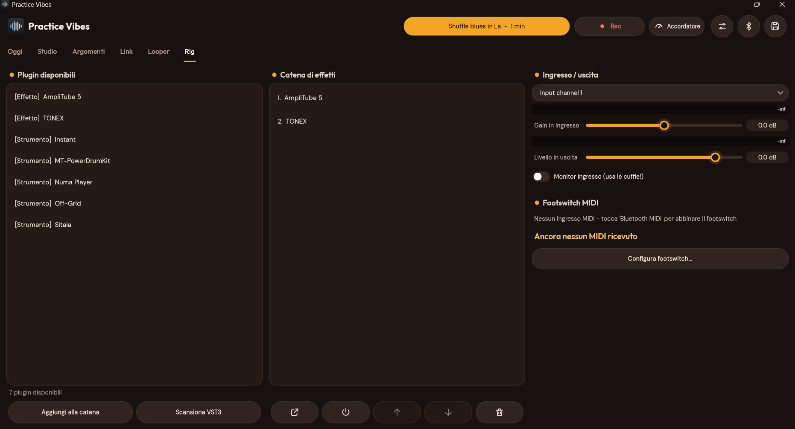

# 10. Rig: i tuoi effetti

La scheda **Rig** è la tua pedaliera. Colleghi simulatori di amplificatore, pedali e altri effetti che hai già, sotto
forma di **plugin**, e il tuo strumento passa attraverso di loro prima che tu lo senta, lo registri o lo metta in loop.

Practice Vibes non ha amplificatori o effetti suoi: usa i plugin, così puoi scegliere i suoni che ti piacciono. Molti
plugin buoni sono gratuiti. Non è obbligatorio averne: con la catena vuota il tuo strumento passa dritto. Spesso è
tutto quello che serve a una tastiera, a una batteria elettronica o a un microfono.

---

## Come funziona

> Pensalo come un percorso di cavi:
>
> **strumento → ingresso dell'interfaccia → Gain in ingresso → plugin 1 → plugin 2 → … → Livello in uscita → cuffie**
>
> - **Gain in ingresso** è come la manopola di ingresso di un amplificatore: quanto forte entra il segnale. Regolalo in
>   modo che l'indicatore di ingresso salga bene quando suoni forte, senza arrivare in cima. Troppo basso e gli effetti
>   suonano deboli e rumorosi; troppo alto e distorce in modo sgradevole prima ancora di arrivarci.
> - La **Catena di effetti** è la tua pedaliera: i plugin lavorano dall'alto in basso, come i pedali dalla chitarra
>   all'amplificatore. L'ordine conta, proprio come con i pedali veri: per esempio wah o compressore prima
>   dell'amplificatore, delay e riverbero dopo.
> - **Livello in uscita** è il volume generale del tuo strumento in cuffia, rispetto a brani, loop e metronomo.
> - **Monitor ingresso** deve essere attivo per sentirlo (capitolo 2).
>
> Brani, metronomo e loop vengono mescolati dopo la catena: non passano per i tuoi effetti (tranne i loop registrati
> "Pre FX", capitolo 7).

---

## Tipi di plugin

I plugin sono app o programmi separati, di altri produttori, che funzionano dentro app "host" come questa:
- **iPad**: plugin **AUv3** (Audio Unit): installali dall'App Store come qualsiasi app (cerca "AUv3 guitar", "AUv3
  bass amp" o "AUv3 reverb"). Compaiono nell'elenco da soli; se ne manca uno, tocca **Aggiorna elenco**.
- **Windows**: plugin **VST3**. Installali con il loro programma di installazione, poi tocca **Scansiona VST3** una
  volta.
- **Mac**: **Audio Unit** (compaiono da sole) e **VST3** (tocca **Scansiona VST3** una volta).

Se un plugin si blocca durante la scansione, viene saltato e annotato nel log; l'app va avanti.

---

## Costruire la catena

1. **Plugin disponibili** elenca quello che è installato. Selezionane uno e tocca **Aggiungi alla catena** (o fai
   doppio tocco).
2. Il plugin compare nella **Catena di effetti**. Selezionalo per:
   - **Apri UI** (icona della finestra): mostrare la finestra del plugin, con le sue manopole e i suoi preset,
   - **Bypass** (icona di accensione): spegnerlo senza toglierlo (come pestare un pedale),
   - **Su** / **Giù** (frecce): cambiarne il posto nella catena,
   - **Rimuovi** (icona del cestino): toglierlo.
3. Suona e regola.

La catena, e le impostazioni di ogni plugin, vengono salvate e tornano la volta successiva.

> **Consiglio:** i plugin usano potenza di calcolo. Se dopo averne aggiunto uno senti crepitii, prova un buffer più
> grande (capitolo 2), o spegni la modalità "alta qualità" / oversampling del plugin. Alcuni simulatori di
> amplificatore aggiungono anche un loro ritardo.

Un footswitch può mettere in bypass il plugin selezionato (capitolo 11).

---

## Suonare una tastiera MIDI attraverso un plugin strumento

Una tastiera MIDI (o un pad) da sola non fa suono. Aggiungi un plugin **strumento** (un pianoforte, un synth, un
campionatore di batteria) e l'app lo suona dalla tua tastiera: lo senti, e il looper e i take registrati lo includono,
proprio come una chitarra attraverso gli effetti.

1. Collega la tastiera (USB, o Bluetooth MIDI sull'iPad).
2. In **Plugin disponibili**, gli strumenti sono segnati **[Strumento]**. Selezionane uno e tocca **Aggiungi alla
   catena**.
3. Va in cima alla catena come **Strumento:** *nome*. Gli effetti restano sotto e ne elaborano il suono (per esempio un
   riverbero su un pianoforte). C'è uno strumento alla volta: aggiungerne un altro sostituisce il precedente.
4. Attiva **Monitor ingresso** per sentirlo (la colonna della catena te lo ricorda), poi suona.

Buono a sapersi:
- **Apri UI** mostra la finestra dello strumento (suoni, preset). **Bypass** lo zittisce, **Rimuovi** lo toglie.
- Il tuo ingresso audio continua a suonare insieme allo strumento. Se suoni solo la tastiera, abbassa **Gain in
  ingresso** per tenere fuori il fruscio dell'interfaccia.
- I messaggi di un footswitch non suonano mai note.
- La modalità **Pre FX** del looper registra solo l'ingresso audio, senza lo strumento: usa **Post FX** (predefinita)
  per mettere in loop la tastiera.
- Strumenti gratuiti per cominciare: su Windows e Mac, per esempio un plugin di pianoforte gratuito; sull'iPad, app
  strumento AUv3 dall'App Store (cerca "AUv3 piano" o "AUv3 synth"). I pianoforti campionati possono usare molta
  memoria, il che conta sugli iPad più vecchi.
- Ritardo: lo strumento non aggiunge un ritardo suo oltre al buffer audio (capitolo 2), quindi le stesse impostazioni
  del buffer che vanno bene per una chitarra vanno bene per la tastiera. Gli altoparlanti di un piano digitale restano
  comunque più rapidi: se preferisci sentire quelli, il plugin strumento non ti serve (le note contano lo stesso come
  tempo di studio, capitolo 3).

Avanti: **[11. Footswitch](11-footswitch.md)**
